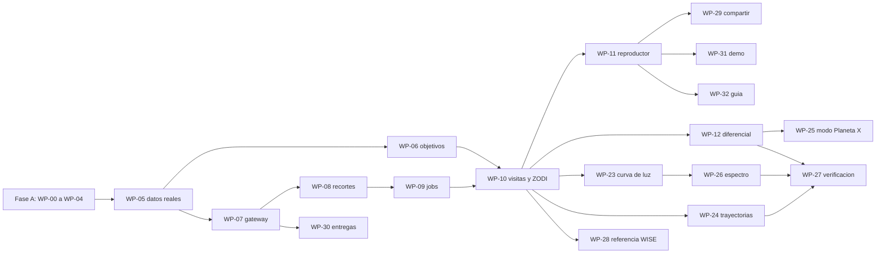

# Auditoría frente al desafío y plan para ganar — NASA Space Apps 2026 "Planet X and SPHEREx"

Versión 2, 2026-11-11, sobre el commit `8be63e2` (rama `developer`). Sustituye a
la versión del 2026-11-10, que contenía afirmaciones incorrectas (§2).

Este documento responde a dos preguntas:

1. **¿Qué le falta hoy a The Origin Project para cumplir el desafío?** (§3 a §6)
2. **¿Qué tenemos que construir para ganarlo?** (§7 a §13)

Documentos relacionados:

- [challenge.md](challenge.md): el enunciado y sus requisitos. Es la brújula.
- [auditoria-tecnica-arquitectonica.md](auditoria-tecnica-arquitectonica.md):
  diagnóstico técnico completo, la **regla de cambio** (§20, RC-1 a RC-14) y los
  paquetes de trabajo WP-00 a WP-22 (§21). Todo lo que se implemente a partir de
  este documento sigue esa regla de cambio sin excepciones.

**Estado:** diagnóstico y plan pendientes de aprobación. Nada está implementado.

---

## 0. Cómo usar este documento

| Si eres | Lee |
|---|---|
| Responsable que decide | §1, §7, §10, §12 |
| Quien implementa (persona o agente) | §9 completo, luego la regla de cambio del documento técnico (§20) |
| Quien presenta la demo | §4, §11, §13 |

Convenciones:

- `ruta:línea` relativa a la raíz del repositorio, en el commit `8be63e2`.
- **Hecho verificado** cita su fuente (código o documentación oficial).
  **Hipótesis** queda marcada así y tiene un paquete de trabajo que la comprueba.
- Los identificadores de hallazgos (FE-, BE-, SCI-, SEC-, UX-, TST-) y de
  paquetes (WP-00 a WP-22) son los del documento técnico. Este documento añade
  los paquetes WP-23 a WP-32 y enmienda algunos existentes (§9.2).

---

## 1. Veredicto

**Hoy The Origin Project no cumple el núcleo del desafío.** El enunciado pide
una cosa concreta: ingresar coordenadas y ver una serie de imágenes SPHEREx de
ese trozo de cielo como un pequeño video, para detectar a simple vista qué se
movió o cambió de brillo. Ese video no existe, la variabilidad no se puede ver
con la normalización actual y tres de los cinco objetivos quedan fuera del
recorte o descentrados.

Lo que sí tiene valor y se conserva: acceso real a IRSA, procesamiento con
Astropy y reproject, una cultura de honestidad sin datos simulados, y un
backend del tamaño correcto.

**La oportunidad para ganar** está en una propiedad de SPHEREx que casi nadie va
a tratar bien: **cada exposición de SPHEREx ve el cielo en un color distinto.**
Un "video" ingenuo de SPHEREx mezcla dos cambios: el del objeto en el tiempo y
el del color en que se observa. La propuesta de este documento es construir el
primer visor público que separa ambos y lo explica:

> **Un flipbook de SPHEREx que entiende la física:** alinea los cuadros, quita la
> luz zodiacal, compara cada época en el mismo color, sigue el movimiento propio
> previsto, y deja al usuario buscar objetos en movimiento con la misma técnica
> que se usa para buscar el Planeta Nueve.

---

## 2. Correcciones a la versión anterior de este documento

| Afirmación de la versión del 2026-11-10 | Estado real | Evidencia |
|---|---|---|
| "Play/pause real entre épocas" | **Incorrecta**: el botón solo mueve un borde entre tarjetas | `frontend/app/time-explorer/page.tsx:72,242` |
| "Comparación (alternancia) COMPLETO: blink + slider" | **Incorrecta**: no hay parpadeo; solo superposición sin alinear | `frontend/app/time-explorer/page.tsx:320-335` |
| "Detectores COMPLETO, punto fuerte real" | Sobreestimada: la guarda no actúa si el campo viene vacío | `backend/app/services/temporal.py:47` |
| "Extracción espectral real por fila vía WCS-WAVE" | **Incorrecta**: el código lee la extensión 5, que según IRSA es la PSF | `backend/app/services/spectral.py:67-71`; orden de extensiones en la documentación de recortes de IRSA |
| "HDU 4 y 5 nunca leídas" | Incorrecta: la 5 (PSF) se lee como si fuera WCS-WAVE; la 6 (WCS-WAVE) nunca | Igual |
| "44/44 tests pasan" | Hoy son 42, ninguno valida ciencia con verdad inyectada | Documento técnico §14 |
| "Temporalidad: agrupa por MJD" | Imprecisa: una "época" por exposición | `frontend/app/time-explorer/page.tsx:34-43` |
| "WISE 0855 correcto a < 0,001 arcsec" | La conversión es correcta, pero se etiqueta como J2000 una posición de la era WISE y no se propaga el movimiento propio | `backend/app/services/targets.py:16-22` |
| Puntuación ≈ 66/100 | Demasiado optimista; §5 | — |

Afirmaciones de la versión anterior que siguen vigentes: los cuatro objetivos sin
fijar dependen de SIMBAD; no hay igualación de PSF; no hay suma de épocas;
`AladinViewer.tsx` es código muerto; el recorte está fijo en 6 arcmin; no hay
coordenadas en la URL; no se acepta formato sexagesimal.

---

## 3. Auditoría frente a cada requisito del desafío

Estados: **Cumple**, **Parcial**, **Falta**, **No verificable** (requiere datos
reales). Un punto solo pasa a Cumple con evidencia observada en la aplicación
desplegada.

### 3.1 Requisitos obligatorios

| ID | Requisito | Estado hoy | Qué falta | Cómo se ve "ganador" | Paquetes |
|---|---|---|---|---|---|
| R1 | Herramienta pública sin barreras | Parcial | El middleware exige sesión en `/time-explorer` si Supabase está configurado (`frontend/middleware.ts:17`); el backend responde 401 en `/analysis/*` con secreto configurado (`backend/app/auth.py:161-166`) | Todo el flujo funciona en una ventana privada; la sesión solo sirve para guardar en el diario | WP-04 |
| R2 | Entrada por RA y Dec | Parcial | Solo grados decimales (`frontend/components/SearchBar.tsx:25-28`); el formato del propio enunciado (`08h55m10.831s -7d14m42.53s`) se envía a SIMBAD como nombre | Acepta decimal, sexagesimal, nombre y la URL `?ra=&dec=` | WP-06, WP-11 |
| R3 | Imágenes reales de SPHEREx | No verificable | Supuestos sin comprobar sobre columnas de SIA2, recorte y extensiones (SCI-10); ruta PyVO siempre falla (BE-03) | Cada cuadro cita su `obs_id`, colección, fecha y detector, y enlaza al producto en IRSA | WP-05, WP-07 |
| R4 | Secuencia como video | **Falta** | No hay ninguna imagen ligada a la reproducción | Reproductor fluido, precargado, con teclado, parpadeo A/B y exportación a video | WP-10, WP-11, WP-29 |
| R5 | Cambio perceptible rápido y sin ser experto | **Falta** | Escala por cuadro (SCI-01), cuadros sin alinear (SCI-02), seis interacciones manuales (UX-04) | Dos interacciones hasta ver la secuencia; el cambio se señala y se explica en lenguaje llano | WP-10, WP-11, WP-24, WP-32 |
| R6 | Funciona en los cinco objetivos | **Falta** en 3, Parcial en 1, No verificable en 1 | §4 | Cada objetivo tiene un enlace permanente que muestra su fenómeno en la demo | WP-06, WP-10, WP-23, WP-31 |

### 3.2 Consideraciones opcionales (diferenciadores)

| ID | Consideración | Estado hoy | Qué falta | Propuesta ganadora | Paquetes |
|---|---|---|---|---|---|
| C1 | Fácil de actualizar con nuevas entregas | Parcial | Colecciones fijas en `backend/app/config.py:29`; DOI y colección de sondeo en código | Las colecciones se descubren en IRSA; una insignia muestra la entrega usada; los resultados se recalculan al cambiar de entrega | WP-30 |
| C2 | Uso creativo de las 102 bandas; sumar por detector | Falta | No existe suma en ningún módulo | Cada cuadro del video es la suma ponderada de todas las exposiciones de un detector dentro de una visita | WP-10 (enmendado) |
| C3 | Espectros al vuelo ("extra kudos") | Falta | Lo actual es un perfil espacial, no un espectro (SCI-06) | Espectro de 102 canales del objetivo construido con su fotometría en cada exposición, más un "termómetro" de color | WP-26 |
| C4 | Sumar o restar épocas | Parcial | Solo resta de dos recortes, sin alineación de PSF | Resta con igualación de PSF, suma por visita y **búsqueda por apilado con desplazamiento** | WP-20, WP-25 |
| C5 | Campo de visión configurable | Falta | `size_arcmin: 6` fijo (`frontend/app/time-explorer/page.tsx:101`) | Selector de campo con el coste de transferencia mostrado; recomendación automática según el movimiento propio | WP-11, WP-24 |
| C6 | Superponer Gaia o WISE | Falta | `AladinViewer.tsx` sin importar | Posición prevista de cada estrella de Gaia en cada cuadro; época de referencia WISE/NEOWISE en el mismo color | WP-18, WP-24, WP-28 |
| C7 | Coordenadas en la URL | Falta | Ninguna ruta lee parámetros | URL completa del estado y modo incrustable con `<iframe>` | WP-11, WP-29 |
| C8 | Metadatos visibles, como banderas de contaminación | Parcial | `flagged_fraction` se calcula y no se muestra | Banderas por cuadro y en la posición del objetivo, con su significado | WP-19, WP-27 |
| C9 | Apoyarse en herramientas públicas | Parcial | Aladin sin usar; PyVO mal invocado | Astropy, reproject, photutils, astroquery (Gaia, IMCCE), Aladin Lite | WP-07, WP-18, WP-27 |

---

## 4. Auditoría por objetivo de prueba

Datos físicos aproximados, para orientar el diseño. Los valores que vayan al
código se toman de SIMBAD o Gaia con su procedencia (RC-8 del documento
técnico); no se copian de esta tabla.

| Objetivo | Fenómeno | Movimiento propio aprox. | Desplazamiento desde J2000 | Desplazamiento en la ventana SPHEREx (mayo 2025 a nov. 2026, unos 1,5 años) |
|---|---|---|---|---|
| Barnard's Star | Movimiento | 10,4 arcsec/año | ≈ 4,5 arcmin | ≈ 16 arcsec ≈ 2,5 píxeles |
| WISE 0855 | Movimiento, objeto muy frío | 8,1 arcsec/año | No aplica: posición de referencia de la era WISE | ≈ 12 arcsec ≈ 2 píxeles |
| Epsilon Indi B | Movimiento, binaria de enanas marrones | 4,7 arcsec/año | ≈ 2 arcmin | ≈ 7 arcsec ≈ 1,1 píxeles |
| RW Aurigae | Brillo, T Tauri irregular | Pequeño | — | — |
| R Draconis | Brillo, Mira con periodo de unos 245 días | Pequeño | — | — |

Píxel de SPHEREx: 6,15 arcsec (documentación de la misión). La paralaje de estos
objetos (≤ 0,55 arcsec) es despreciable frente al píxel.

### 4.1 Estado y necesidades por objetivo

**Barnard's Star**
- Hoy: sin fijar; depende de SIMBAD; con la posición J2000 queda **fuera** del
  recorte de 3 arcmin de radio.
- Necesita: posición propagada a la fecha de cada cuadro (WP-06); recorte
  centrado en la posición propagada; la estrella es brillante, por lo que 2,5
  píxeles en 1,5 años se ven en un parpadeo entre la primera y la última visita.
- Riesgo: saturación o persistencia en el detector (hipótesis; WP-05 lo
  comprueba con las banderas).
- Demo: "la estrella se desplaza sobre un fondo fijo de estrellas de Gaia", con
  la trayectoria prevista dibujada.

**WISE 0855**
- Hoy: fijado con las coordenadas del enunciado; etiquetado como J2000 por
  error; criterio de detección que pierde fuentes puntuales (SCI-08).
- Necesita: tratar la posición del enunciado como posición en una época de
  referencia a confirmar (WP-06); suma por visita en el detector de mayor
  longitud de onda (WP-10); búsqueda por apilado con desplazamiento (WP-25).
- **Hipótesis central de la demo:** al ser una enana marrón de unos 250 K, su
  emisión debería concentrarse en el extremo largo del rango de SPHEREx (en
  torno a 4,5 µm) y ser casi invisible por debajo de unos 3 µm. Si WP-05 lo
  confirma, es la mejor historia posible: "así se vería un Planeta X frío".
- Riesgo: puede estar en el límite de detección incluso sumando. Si no se
  detecta, la herramienta lo dice y muestra el límite superior.

**Epsilon Indi B**
- Hoy: depende de SIMBAD; unos 2 arcmin descentrado.
- Necesita: propagación (WP-06). Las dos enanas marrones están separadas menos
  de un arcosegundo: **SPHEREx no puede separarlas** y la interfaz debe
  decirlo. Epsilon Indi A, muy brillante, está a unos 6 o 7 arcmin (verificar):
  puede quedar en el campo y producir artefactos.
- Con 1,1 píxeles en 1,5 años el movimiento es marginal solo con SPHEREx. La
  época de referencia WISE (2010) amplía la base a unos 16 años y unos 75 arcsec
  (WP-28), rotulada como contexto de otra misión.

**RW Aurigae**
- Hoy: sin escala compartida ni fotometría; la variabilidad es invisible.
- Necesita: modo brillo con escala física compartida, resta de luz zodiacal,
  fotometría diferencial frente a estrellas de comparación (WP-23).
- Es una binaria no resuelta por SPHEREx con disco; su variabilidad es
  irregular. La interfaz no debe prometer un periodo.

**R Draconis**
- Hoy: igual que RW Aurigae.
- Necesita: lo mismo. Con un periodo de unos 245 días, la ventana de 1,5 años
  cubre más de dos ciclos: si hay visitas suficientes, la curva de luz debería
  mostrar el ciclo (hipótesis; depende de la cobertura real).
- Está a alta declinación, cerca del polo norte de la eclíptica, donde SPHEREx
  observa con más frecuencia (hipótesis a confirmar en WP-05).

### 4.2 Criterio de aceptación de la demo por objetivo

| Objetivo | Se considera listo cuando, en la aplicación desplegada |
|---|---|
| Barnard's Star | El enlace permanente muestra al menos dos visitas alineadas y el desplazamiento medido coincide con el previsto dentro de su incertidumbre |
| WISE 0855 | Se muestra su detección en la suma de visitas con su significancia, o un límite superior explícito; la búsqueda por apilado recupera la dirección de movimiento sin conocerla de antemano, o declara que no hay señal suficiente |
| Epsilon Indi B | Secuencia centrada en la posición propagada, con el aviso de binaria no resuelta y de la estrella brillante cercana |
| RW Aurigae, R Draconis | Curva de luz por detector con barras de error y estrellas de comparación; la variación del objetivo supera la dispersión de las comparaciones, o la herramienta dice que no la supera |

---

## 5. Evaluación frente a los criterios del jurado

Criterios tomados de `docs/challenge.md` (confirmar la rúbrica vigente de 2026).

| Criterio | Hoy (0-10) | Motivo | Objetivo tras el plan | Qué lo mueve |
|---|---|---|---|---|
| Impacto | 3 | Un voluntario no puede ver un cambio | 8 | Flipbook directo, explicaciones, verificación de candidatos |
| Creatividad | 4 | Diario con hash; el resto es un visor convencional | 9 | Separación de color y tiempo; búsqueda por apilado; termómetro de color |
| Validez | 3 | Candidatos en (0, 0), escala por cuadro, "espectro" incorrecto | 8 | Resta de luz zodiacal, fotometría diferencial, pruebas con verdad inyectada |
| Relevancia | 5 | Apunta al problema correcto sin resolverlo | 9 | R1 a R6 y siete de las nueve consideraciones cubiertas |
| Presentación | 4 | No hay nada que se mueva en pantalla | 9 | Cinco enlaces permanentes, video exportado, guion de §13 |

Promedio simple actual: **3,8/10**. Es una estimación del equipo auditor, no del
jurado.

---

## 6. Contra qué compite el proyecto

| Herramienta | Qué ofrece | Qué no ofrece |
|---|---|---|
| SPHEREx Data Explorer (IRSA) | Visor de imágenes, recortes, espectrofotometría, catálogos | Secuencia temporal para público general; separación de color y tiempo; guía de verificación |
| Cuadernos de IRSA (recortes, PSF, descubrimiento de fuentes) | Recetas en Python para científicos | Interfaz web; flujo para no expertos |
| Backyard Worlds | Flipbooks de WISE para voluntarios, modelo probado de ciencia ciudadana | Datos de SPHEREx; información espectral |
| Equipos rivales del desafío | Previsiblemente, un reproductor de recortes de SPHEREx | Muy probablemente: alineación, escala compartida, luz zodiacal, comparación en el mismo color |

**Tesis de diferenciación:** no competir como visor de FITS (IRSA lo hace mejor).
Competir como **el Backyard Worlds de SPHEREx**: un flipbook honesto, que explica
qué es un cambio real y qué es un efecto del instrumento, y que guía a un
voluntario desde "veo algo" hasta "esto es un candidato verificado contra
catálogos".

---

## 7. Propuesta de producto para ganar

Siete pilares. Cada uno indica qué es, por qué gana, en qué se apoya
científicamente, cómo se valida y su riesgo.

### Pilar 1 · Flipbook honesto por visita y detector (núcleo; R4, R5, C2)

**Qué es.** Cada cuadro del video no es una exposición suelta, sino una
**visita**: todas las exposiciones del mismo detector que caen en el objetivo
dentro de una ventana corta de tiempo, sumadas con peso de varianza inversa,
tras restar la luz zodiacal y reproyectar a una rejilla común (norte arriba).

**Por qué gana.**
- Resuelve la tensión del propio enunciado: muchas exposiciones mezclan colores;
  una visita por detector tiene siempre la misma banda ancha. Así el video
  compara peras con peras.
- Cumple C2 de la forma que el enunciado sugiere ("sumar los datos de cada uno
  de los 6 detectores para mejorar señal/ruido").
- Hace visibles objetos débiles como WISE 0855.

**Base científica.**
- SPHEREx tiene seis detectores, cada uno cubre un tramo del rango de 0,75 a
  5 µm; cada píxel tiene su propia longitud de onda (documentación de IRSA y
  artículo del pipeline, arXiv:2511.15823).
- IRSA **no** resta la luz zodiacal en las imágenes; la entrega un modelo en la
  extensión ZODI (documentación de productos de IRSA). La luz zodiacal cambia
  con la geometría de cada época, así que sin restarla una comparación de
  brillo entre épocas no es válida.

**Validación.** Pruebas sintéticas de WP-10: escala compartida, alineación,
orientación, exclusión de detectores mezclados; y una prueba nueva: dos visitas
con la misma estrella y distinto fondo zodiacal producen el mismo flujo tras
la resta.

**Riesgo.** Definir "visita" depende de la cadencia real (hipótesis). WP-05
mide la distribución de tiempos entre exposiciones por objetivo y de ahí sale
la ventana.

### Pilar 2 · El movimiento se ve aunque sea menor que un píxel (Barnard, WISE 0855, Epsilon Indi B)

**Qué es.** Tres herramientas superpuestas al flipbook:

1. **Trayectoria prevista.** Para el objetivo y para cada estrella de Gaia del
   campo, su posición prevista en la fecha de cada cuadro. Lo que sigue su
   trayectoria es conocido; lo que se mueve sin trayectoria prevista es
   interesante.
2. **Búsqueda por apilado con desplazamiento ("modo Planeta X").** El usuario
   elige una dirección y una velocidad (o deja que la herramienta recorra una
   rejilla) y las visitas se suman desplazadas a lo largo de ese movimiento. Un
   objeto que se mueve así se concentra en un punto y destaca; las estrellas
   fijas se emborronan.
3. **Época de referencia.** Opcional y rotulada como otra misión: una imagen de
   WISE o NEOWISE en un color equivalente (3,4 o 4,6 µm) para ampliar la base
   temporal a más de una década.

**Por qué gana.** La búsqueda por apilado es la técnica real con la que se busca
el Planeta Nueve y objetos lejanos ("digital tracking" o "shift-and-stack";
por ejemplo, la búsqueda con WISE y NEOWISE, arXiv:1611.00015, o la de TESS,
arXiv:2010.13791). Ponerla en manos de un voluntario, con datos de SPHEREx y
explicada en lenguaje llano, conecta directamente con el título del desafío.
La demo puede mostrar que la herramienta **recupera a ciegas** la dirección de
movimiento de WISE 0855.

**Validación.**
- Prueba sintética: una fuente débil inyectada que se mueve 1 píxel por visita,
  invisible en cada cuadro (SNR 2 por cuadro), se recupera en la suma desplazada
  con SNR aproximadamente igual a 2 por raíz del número de visitas, y la
  velocidad recuperada coincide con la inyectada dentro de un píxel por periodo.
- Con datos reales: el movimiento recuperado de Barnard y WISE 0855 coincide con
  el del catálogo dentro de su incertidumbre (o se declara sin señal
  suficiente).

**Riesgo.** Con pocas visitas, la búsqueda puede no tener poder estadístico.
La herramienta debe mostrar el número de visitas y la significancia, y nunca
un "resultado" por debajo del umbral.

### Pilar 3 · El brillo es confiable (RW Aurigae, R Draconis)

**Qué es.**
- Fotometría de apertura del objetivo en cada visita, con resta de fondo en
  anillo y error tomado de la extensión VARIANCE.
- **Fotometría diferencial:** las mismas medidas sobre 5 a 10 estrellas de
  comparación del campo, elegidas en Gaia por brillo similar y sin variabilidad
  conocida. Se muestran juntas: si el objetivo cambia y las comparaciones no,
  el cambio es del objetivo; si todas cambian, es del instrumento o del fondo.
- **Corrección por color:** dentro de un detector, la longitud de onda efectiva
  en la posición del objetivo varía entre exposiciones. Se ajusta la forma del
  espectro del objetivo con todos los datos y se muestra la variabilidad como
  residuo respecto a esa forma, de modo que un cambio de color del instrumento
  no se confunda con un cambio de brillo del objeto.

**Por qué gana.** Es lo que haría un astrónomo antes de afirmar variabilidad, y
casi ningún visor público lo hace. Responde de forma directa a la pregunta que
hará un jurado especialista: "¿cómo sabéis que el cambio es real?".

**Validación.** Pruebas sintéticas de WP-23: una variable inyectada con
amplitud conocida se recupera dentro del error; una estrella constante con
variación sintética del fondo zodiacal sale constante tras la resta; una
variación común a todas las estrellas se cancela en la fotometría diferencial.

**Riesgo.** La corrección por color es la parte más nueva y menos probada. Si
no se valida a tiempo, se entrega la curva por detector sin ella y se rotula
"sin corrección de color".

### Pilar 4 · Espectro al vuelo y termómetro de color (C3)

**Qué es.**
- El espectro del objetivo se construye con su fotometría en **cada
  exposición**, situada en la longitud de onda que la tabla WCS-WAVE asigna a
  ese píxel (este es el método correcto para SPHEREx; el actual perfil por filas
  no lo es).
- Un **termómetro de color** compara el flujo en los detectores de longitud de
  onda corta y larga. Explicado al público: "los objetos fríos, como las enanas
  marrones o un hipotético Planeta X, casi no brillan en azul infrarrojo y sí en
  rojo infrarrojo".

**Por qué gana.** Es el "extra kudos" explícito del enunciado y convierte las
102 bandas en una herramienta de descubrimiento, no en un adorno. El termómetro
es una forma nueva y comprensible de usar el espectro para decidir si un
candidato merece atención.

**Validación.** Prueba sintética: con un mapa de longitud de onda y un espectro
inyectado conocidos, el espectro recuperado coincide dentro del 10 % y cada
punto cae dentro del ancho de su canal. Con datos reales: la forma general del
espectro de R Draconis o Barnard es coherente con su tipo espectral (comparación
cualitativa, rotulada como tal).

**Riesgo.** Sin corrección de apertura ni calibración absoluta, el espectro es
relativo. Se rotula "espectrofotometría relativa, sin corrección de apertura".

### Pilar 5 · Verificar como un científico (C8, credibilidad)

**Qué es.** Para cualquier fuente que el usuario marque, una lista de
comprobación automática y visible:

| Comprobación | Fuente | Resultado mostrado |
|---|---|---|
| ¿Es una estrella conocida de Gaia en su posición prevista? | Gaia DR3 por astroquery | Coincide o no, con la distancia |
| ¿Es un asteroide o cometa conocido en esa fecha? | IMCCE SkyBoT por `astroquery.imcce` (búsqueda por cono y época) | Nombre del objeto o ninguno |
| ¿Tiene banderas de calidad en esos píxeles? | Extensión FLAGS | Bits activos y su significado |
| ¿Aparece en al menos dos visitas? | Visitas | Número de visitas con detección |
| ¿Su movimiento es coherente entre visitas? | Ajuste lineal | Velocidad y error, o incoherente |
| ¿Tiene forma de fuente puntual? | Extensión PSF | Compatible o no |
| ¿Qué color tiene? | Pilar 4 | Posición en el termómetro |

El resultado es una **categoría**, nunca un descubrimiento: artefacto probable,
objeto conocido, candidato sin explicar. El informe de evidencia (WP-14) guarda
todas las comprobaciones.

**Por qué gana.** Protege la credibilidad del proyecto y enseña a los
voluntarios el método real. La comprobación de asteroides conocidos es
imprescindible: el campo de cualquier búsqueda de movimiento está lleno de
asteroides, y presentar uno como Planeta X arruinaría la demo.

**Validación.** Simulacros de Gaia y SkyBoT en las pruebas; con datos reales, un
asteroide conocido que cruce un campo se identifica por su nombre (si WP-05
encuentra uno).

### Pilar 6 · Compartir, incrustar y presentar (C7, presentación)

**Qué es.**
- La URL contiene todo el estado: objetivo, campo, modo, cuadro y detector.
- Modo incrustable (`?embed=1`) para usarlo en otros sitios, como pide C7.
- Exportación del flipbook a video WebM o GIF animado desde el navegador, con
  la fecha y el detector impresos en cada cuadro y la fuente de los datos.
- Enlace a cada producto original en IRSA.

**Por qué gana.** El jurado y el público se llevan el resultado. Un video corto
de Barnard moviéndose sobre estrellas de Gaia es material de presentación de
primera.

### Pilar 7 · Listo para la siguiente entrega de datos (C1)

**Qué es.** Las colecciones disponibles se descubren consultando IRSA, no se
fijan en código; la interfaz muestra qué entrega se usó; cambiar de entrega o de
versión de procesado invalida la caché y los resultados por clave.

**Por qué gana.** C1 lo pide explícitamente ("los datos de SPHEREx llegan
rápido"), y es barato una vez que existe `PROCESSING_VERSION` en las claves.

---

## 8. Lo que no se hace

Según "Fuera de foco" de `docs/challenge.md` y la regla final del encargo:

- No se añade infraestructura (Redis, DragonflyDB, colas, WebSockets) para este
  plan. Ninguno de los pilares la necesita a la escala del desafío.
- No se muestran visualizaciones decorativas en el flujo principal. La esfera
  celeste se conserva solo como mapa de cobertura (huellas observadas).
- No se clasifica automáticamente un objeto como descubrimiento. La herramienta
  asiste al ojo del usuario, no lo sustituye.
- No se rellenan huecos con datos sintéticos. Sin cobertura, se dice.
- No se compite como visor genérico de FITS.

---

## 9. Plan de implementación

Toda la implementación sigue la regla de cambio del documento técnico (§20):
aprobación por paquete, prueba primero, superficie de edición cerrada,
invariantes científicos y cuándo detenerse.

### 9.1 Fases y puertas

| Fase | Objetivo | Paquetes | Puerta para pasar a la siguiente |
|---|---|---|---|
| A | Seguridad y producción | WP-00, WP-01, WP-02, WP-03, WP-04 | El sitio desplegado muestra datos y el flujo no pide sesión |
| B0 | Conocer los datos | WP-05 (ampliado) | Tabla de cobertura y cadencia de los cinco objetivos; extensiones confirmadas. **Puede cambiar el diseño de todo lo demás** |
| B | Núcleo: el flipbook | WP-06, WP-07, WP-08, WP-09, WP-10 (enmendado), WP-11 | Los cinco enlaces permanentes reproducen una secuencia alineada |
| C | Ciencia que convence | WP-12, WP-23, WP-24, WP-14 | Curvas de luz con comparaciones; trayectorias previstas; ningún candidato en (0, 0) |
| D | Diferenciadores | WP-25, WP-26, WP-27, WP-28 | Búsqueda por apilado, espectro y verificación funcionando en al menos un objetivo cada uno |
| E | Presentación y robustez | WP-29, WP-30, WP-31, WP-32, WP-15 a WP-19, WP-21, WP-22 | Lista de §10 completa |

Si el tiempo no alcanza, el orden de recorte está en §12.

### 9.2 Enmiendas a paquetes del documento técnico

Estas enmiendas sustituyen el texto correspondiente de
`docs/auditoria-tecnica-arquitectonica.md` §21. Quien implemente aplica el
paquete original con estos cambios.

**WP-05 (ampliado): verificar los supuestos contra datos reales.** Además de lo
ya listado, registrar para cada objetivo:
1. Fechas de todas las exposiciones que lo contienen, por detector, y la
   distribución de intervalos entre ellas (para definir "visita").
2. Longitud de onda en la posición del objetivo para cada exposición, leída de
   WCS-WAVE.
3. Magnitud del modelo ZODI en la posición del objetivo por exposición.
4. Contenido de los encabezados de la extensión PSF y la errata publicada por
   IRSA sobre sus zonas.
5. Si WISE 0855 aparece en una suma simple de las exposiciones del detector de
   mayor longitud de onda (comprobación rápida de la hipótesis de §4.1).
6. Disponibilidad y forma de acceso de imágenes WISE/NEOWISE en IRSA para los
   cinco campos (para WP-28).

**WP-10 (enmendado): motor de secuencia.**
- El cuadro de la secuencia es una **visita**: exposiciones del mismo detector
  dentro de la ventana definida en WP-05, sumadas con peso de varianza inversa
  sobre la rejilla común. Se conserva la opción de ver exposiciones sueltas.
- Antes de sumar o escalar, se resta a cada exposición su modelo ZODI. El
  resultado declara `zodi_subtracted: true`.
- El centro del recorte de cada visita es la posición del objetivo propagada a
  la fecha media de esa visita, pero la rejilla común se fija en el cielo (no se
  mueve con el objetivo), de modo que el movimiento se vea.
- Cada cuadro informa `n_exposures`, `wavelength_range_um` y
  `effective_wavelength_um` en la posición del objetivo.
- Criterios de aceptación adicionales:
  1. Dos exposiciones con la misma estrella y distinto nivel de ZODI dan el
     mismo flujo de estrella tras la resta, con error menor que el 5 %.
  2. La SNR de una fuente estática en una visita de N exposiciones crece como
     raíz de N con error menor que el 15 %.
  3. Una visita nunca mezcla detectores.

**WP-13: sustituido por WP-26.** Se conserva solo su parte mínima (acceso por
`EXTNAME` y dejar de llamar espectro al perfil espacial), que se hace dentro de
WP-26.

**WP-18 (enmendado): Aladin.** Además de las capas de Gaia y WISE, Aladin se
sincroniza con el cuadro actual del flipbook (misma fecha) y muestra las
posiciones de Gaia propagadas a esa fecha (las calcula WP-24).

**WP-20 (enmendado).** Queda solo la igualación de PSF antes de la resta. La
suma por visita pasa a WP-10 y la búsqueda por apilado a WP-25.

### 9.3 Paquetes nuevos

Formato idéntico al del documento técnico. "Verificación independiente" indica
validez científica, contrato nuevo o servicio externo nuevo.

#### WP-23 · Fotometría diferencial y curva de luz

- **Pilar:** 3. **Requisitos:** R5, R6 (RW Aurigae, R Draconis).
  **Depende de:** WP-10 enmendado. **Tamaño:** M. **Verificación
  independiente:** sí.
- **Servicio externo nuevo:** Gaia DR3 mediante `astroquery.gaia` (ya incluido
  en astroquery; sin dependencia nueva). Plazo total y caché por campo.
- **Superficie de edición:** `backend/app/services/photometry.py` (nuevo),
  `backend/app/services/catalogs.py` (nuevo),
  `backend/app/services/sequence.py`, `backend/app/schemas.py`,
  `frontend/components/LightCurve.tsx` (nuevo),
  `frontend/app/time-explorer/page.tsx`,
  `backend/tests/test_photometry_synthetic.py` (nuevo),
  `docs/api-contract.md`.
- **Cambio:**
  1. Fotometría de apertura por visita en la posición propagada del objetivo:
     radio en función del ancho de la PSF, anillo de fondo, error desde
     VARIANCE, fracción de píxeles con bandera.
  2. Selección de 5 a 10 estrellas de comparación en Gaia: brillo similar,
     aisladas, dentro del campo y sin bandera de variabilidad en Gaia.
  3. Curva relativa: flujo del objetivo dividido por la mediana de las
     comparaciones, normalizada; dispersión de las comparaciones mostrada como
     banda de referencia.
  4. Una curva por detector. Nunca se mezclan detectores en una curva.
  5. Corrección por color opcional, rotulada; si no está validada, desactivada.
- **Criterios de aceptación (sintéticos):**
  1. Variable inyectada con amplitud del 30 %: amplitud recuperada dentro del
     error estimado.
  2. Estrella constante con un 20 % de variación común inyectada en todo el
     cuadro: curva relativa plana dentro del error.
  3. Estrella constante con fondo ZODI variable: curva plana tras la resta.
  4. Píxel con bandera en la apertura: el punto se marca y se excluye del ajuste.
  5. Sin estrellas de comparación válidas: la curva se muestra como absoluta y
     se rotula.
- **Fuera de alcance:** periodos, clasificación de variables.

#### WP-24 · Trayectorias previstas y estrellas de referencia

- **Pilar:** 2. **Requisitos:** R5, R6 (movimiento), C5, C6. **Depende de:**
  WP-06, WP-10. **Tamaño:** M.
- **Servicio externo nuevo:** Gaia DR3, compartido con WP-23.
- **Superficie de edición:** `backend/app/services/catalogs.py`,
  `backend/app/routers/sequences.py`, `backend/app/schemas.py`,
  `frontend/components/SequencePlayer.tsx`,
  `backend/tests/test_catalogs.py` (nuevo), `docs/api-contract.md`.
- **Cambio:**
  1. Para cada visita, posición prevista del objetivo y de las estrellas de Gaia
     del campo hasta una magnitud límite, propagadas con
     `SkyCoord.apply_space_motion` a la fecha media de la visita y convertidas a
     píxeles de la rejilla común.
  2. Superposición en el reproductor, activable: marcas de Gaia, trayectoria del
     objetivo entre la primera y la última visita, y círculo de incertidumbre.
  3. Desplazamiento medido del objetivo frente al previsto, si WP-12 lo mide.
  4. Recomendación de campo de visión: si el desplazamiento previsto en la
     ventana supera la mitad del campo, se sugiere uno mayor.
- **Criterios de aceptación:**
  1. Una estrella sintética con 10 000 mas/año en declinación aparece 100 arcsec
     más al norte en una visita 10 años posterior, con error menor que 0,1
     arcsec.
  2. Las marcas de Gaia de un campo sintético coinciden con las fuentes
     inyectadas dentro de un píxel.
  3. Con Gaia inaccesible, la secuencia se muestra igual y la capa queda
     desactivada con un aviso.

#### WP-25 · Búsqueda por apilado con desplazamiento ("modo Planeta X")

- **Pilar:** 2. **Requisitos:** C4, R6 (WISE 0855). **Depende de:** WP-10,
  WP-12. **Tamaño:** L. **Verificación independiente:** sí.
- **Superficie de edición:** `backend/app/services/shift_stack.py` (nuevo),
  `backend/app/routers/sequences.py`, `backend/app/schemas.py`,
  `frontend/components/ShiftStackPanel.tsx` (nuevo),
  `backend/tests/test_shift_stack_synthetic.py` (nuevo),
  `docs/api-contract.md`.
- **Cambio:**
  1. Entrada: una secuencia de visitas del mismo detector, una rejilla de
     velocidades (dirección y módulo, en arcsec/año) con un máximo de
     combinaciones configurable.
  2. Para cada velocidad, desplazar cada visita según su fecha y sumar con peso
     de varianza inversa; medir la significancia del pico en la posición
     esperada.
  3. Salida: mapa de significancia sobre la rejilla de velocidades, la mejor
     velocidad, su significancia corregida por el número de pruebas (penalización
     por búsqueda múltiple), y la imagen apilada correspondiente.
  4. Modo manual en la interfaz: el usuario arrastra un vector y ve la suma en
     tiempo casi real (sobre cuadros ya calculados en el navegador o con
     llamadas cacheadas por velocidad).
  5. Se ejecuta como job con progreso y bajo el semáforo de WP-09.
- **Criterios de aceptación (sintéticos):**
  1. Fuente inyectada con SNR 2 por visita y 1 píxel por visita en 8 visitas:
     velocidad recuperada dentro de 0,5 píxeles por intervalo y significancia
     del apilado de al menos 5.
  2. Solo ruido: la significancia corregida de la mejor velocidad supera el
     umbral en el 2 % de los casos como máximo.
  3. Una estrella fija brillante no produce un pico en velocidades distintas de
     cero (se enmascara o se resta antes).
  4. Con menos de tres visitas, el job termina con una limitación explícita y
     sin resultado.
- **Fuera de alcance:** órbitas no lineales (para objetos lejanos, el
  movimiento lineal en 1,5 años es una aproximación aceptable que se declara).

#### WP-26 · Espectro al vuelo y termómetro de color

- **Pilar:** 4. **Requisitos:** C3. **Depende de:** WP-05, WP-10, WP-23.
  **Tamaño:** L. **Verificación independiente:** sí.
- **Superficie de edición:** `backend/app/services/spectral.py`,
  `backend/app/services/fits_processing.py`,
  `backend/app/services/photometry.py`, `backend/app/routers/analysis.py`,
  `frontend/app/spectral-lab/page.tsx`,
  `backend/tests/test_spectral_synthetic.py` (nuevo),
  `docs/api-contract.md`.
- **Cambio:**
  1. Acceso a todas las extensiones por `EXTNAME` (corrige SCI-06).
  2. Para cada exposición del objetivo: fotometría de apertura (WP-23) tras
     restar ZODI, y longitud de onda y ancho de banda en el píxel del objetivo
     desde WCS-WAVE.
  3. Espectro: flujo frente a longitud de onda, con error, coloreado por fecha
     para que la variabilidad se distinga de la forma espectral.
  4. Termómetro de color: razón entre el flujo medio en el detector de mayor
     longitud de onda y en uno de menor, con su error y una explicación en
     lenguaje llano; referencias cualitativas rotuladas (estrella normal frente
     a objeto frío) que no se presentan como calibración.
  5. Rotulado fijo: "espectrofotometría relativa, sin corrección de apertura".
- **Criterios de aceptación:**
  1. FITS con extensiones en otro orden: se procesa igual.
  2. Espectro inyectado conocido sobre un mapa de longitud de onda sintético:
     recuperado dentro del 10 % y cada punto dentro de su canal.
  3. Objeto sintético frío (flujo solo en el detector largo) frente a uno con
     espectro plano: el termómetro los separa con al menos 3 sigma.
  4. Ningún texto llama espectro al perfil espacial antiguo.

#### WP-27 · Verificación de candidatos

- **Pilar:** 5. **Requisitos:** C8, credibilidad. **Depende de:** WP-12, WP-24,
  WP-26. **Tamaño:** M. **Verificación independiente:** sí.
- **Servicio externo nuevo:** IMCCE SkyBoT mediante `astroquery.imcce` (ya
  incluido en astroquery). Plazo total y caché por campo y época.
- **Superficie de edición:** `backend/app/services/vetting.py` (nuevo),
  `backend/app/services/catalogs.py`, `backend/app/routers/analysis.py`,
  `backend/app/schemas.py`, `frontend/components/VettingPanel.tsx` (nuevo),
  `backend/tests/test_vetting.py` (nuevo), `docs/api-contract.md`.
- **Cambio:** las siete comprobaciones de §7, pilar 5, ejecutadas sobre una
  fuente marcada; resultado en una de tres categorías (artefacto probable,
  objeto conocido, candidato sin explicar), cada comprobación con su evidencia;
  la categoría y las comprobaciones entran en el informe de evidencia.
- **Criterios de aceptación (con simulacros):**
  1. Un asteroide devuelto por SkyBoT en la posición y fecha de la fuente da
     "objeto conocido" con su nombre.
  2. Una fuente que coincide con una estrella de Gaia en su posición prevista da
     "objeto conocido".
  3. Una fuente en píxeles con bandera y en una sola visita da "artefacto
     probable".
  4. Con SkyBoT o Gaia inaccesibles, la comprobación figura como "no
     comprobada" y la categoría nunca pasa a "candidato sin explicar" por
     omisión.
  5. Ningún texto usa "descubrimiento".

#### WP-28 · Época de referencia WISE/NEOWISE

- **Pilar:** 2. **Requisitos:** C6, R6 (Epsilon Indi B). **Depende de:** WP-05
  (acceso confirmado), WP-10. **Decisión:** D14. **Tamaño:** M.
- **Superficie de edición:** `backend/app/services/reference_epoch.py` (nuevo),
  `backend/app/routers/sequences.py`, `backend/app/config.py`,
  `frontend/components/SequencePlayer.tsx`,
  `backend/tests/test_reference_epoch.py` (nuevo), `docs/api-contract.md`.
- **Cambio:** obtener de IRSA una imagen WISE o NEOWISE del campo en la banda más
  cercana a la del detector elegido (W1 3,4 µm o W2 4,6 µm), reproyectarla a la
  rejilla común y ofrecerla como cuadro de referencia, activable, con un rótulo
  permanente "otra misión, otra resolución". Nunca se resta de SPHEREx sin
  igualar PSF.
- **Criterios de aceptación:**
  1. El cuadro de referencia aparece separado visualmente y con su rótulo.
  2. Las estrellas de Gaia propagadas a la fecha WISE coinciden con las fuentes
     de la imagen WISE dentro de un píxel de SPHEREx.
  3. Desactivado por defecto si D14 así lo decide.

#### WP-29 · Compartir, incrustar y exportar

- **Pilar:** 6. **Requisitos:** C7, presentación. **Depende de:** WP-11.
  **Tamaño:** S.
- **Superficie de edición:** `frontend/components/SequencePlayer.tsx`,
  `frontend/app/time-explorer/page.tsx`, `frontend/next.config.js` (solo la
  cabecera que permite el modo incrustado en esa ruta).
- **Cambio:** botón "Copiar enlace" con el estado completo; `?embed=1` muestra
  solo el reproductor y un enlace a la herramienta; exportación a WebM con
  `MediaRecorder` sobre un lienzo y respaldo a una secuencia de PNG; cada cuadro
  exportado lleva fecha, detector y "Datos: NASA/IPAC IRSA, SPHEREx".
- **Criterios de aceptación:** la URL copiada reproduce el mismo estado en otra
  ventana; el modo incrustado funciona dentro de un `<iframe>` de otro origen;
  el video exportado tiene tantos cuadros como la secuencia y los rótulos
  legibles.
- **Nota:** la cabecera `X-Frame-Options: DENY` de WP-16 se exceptúa solo para
  el modo incrustado, con `Content-Security-Policy: frame-ancestors *` en esa
  ruta.

#### WP-30 · Entregas de datos descubiertas, no fijadas

- **Pilar:** 7. **Requisitos:** C1. **Depende de:** WP-07. **Tamaño:** S.
- **Superficie de edición:** `backend/app/services/sia2_gateway.py`,
  `backend/app/config.py`, `backend/app/services/evidence.py`,
  `frontend/components/StatusBanner.tsx`,
  `backend/tests/test_sia2.py`.
- **Cambio:** al arrancar y cada 24 horas, consultar a IRSA qué colecciones
  SPHEREx existen y elegir la más reciente de cada tipo, con la lista
  configurada como respaldo; mostrar la entrega usada; los DOI se derivan de la
  colección elegida mediante una tabla de datos, no del código.
- **Criterios de aceptación:** con una respuesta simulada que añade una
  colección nueva, la siguiente búsqueda la usa sin cambiar código; con IRSA
  inaccesible, se usa la lista configurada y se avisa.

#### WP-31 · Demo a prueba de escenario

- **Requisitos:** R6, presentación. **Depende de:** WP-10, WP-11. **Tamaño:** S.
- **Superficie de edición:** `backend/app/routers/system.py`,
  `backend/scripts/warm_targets.py` (nuevo), `docs/demo.md` (nuevo).
- **Cambio:**
  1. Script que prepara y deja en caché las secuencias de los cinco objetivos
     (datos reales, con su fecha de consulta).
  2. Comprobación previa a la demo: los cinco enlaces permanentes responden y
     muestran al menos dos visitas.
  3. Si IRSA no responde en el escenario, la aplicación sirve los resultados
     reales ya calculados rotulados "consultado el <fecha>, en caché". Nunca
     datos sintéticos.
  4. `docs/demo.md` con los cinco enlaces, el guion de §13 y qué hacer si algo
     falla.
- **Criterios de aceptación:** con la red del backend hacia IRSA cortada, los
  cinco enlaces siguen mostrando su secuencia con el rótulo de caché.

#### WP-32 · Guía para no expertos

- **Requisitos:** R5, impacto. **Depende de:** WP-11, WP-23, WP-24.
  **Tamaño:** S.
- **Superficie de edición:** `frontend/components/Tutorial.tsx`,
  `frontend/components/Explainer.tsx` (nuevo),
  `frontend/app/page.tsx`, `frontend/app/time-explorer/page.tsx`.
- **Cambio:**
  1. Portada con los cinco objetivos como tarjetas ("Mira cómo se mueve la
     estrella de Barnard", "Mira cómo late R Draconis"), cada una abre su enlace
     permanente.
  2. Panel "¿Qué estoy viendo?" junto al reproductor: qué es cada cuadro, por
     qué cambia de color de un detector a otro, qué es la luz zodiacal, qué
     significa la escala.
  3. Cada resultado con su etiqueta: observación, cálculo, candidato.
  4. Glosario breve en el idioma elegido en D4.
- **Criterios de aceptación:** una persona sin formación en astronomía, sin
  ayuda, llega al video de un objetivo y explica qué cambió (prueba con al menos
  tres personas, resultados anotados en `docs/demo.md`).

### 9.4 Grafo de dependencias

---

## 10. Definición de listo para el desafío

El proyecto está listo para presentarse cuando todo esto se ha observado en la
aplicación desplegada, no en local:

- [ ] Una ventana privada abre la herramienta y llega al video sin iniciar sesión (R1).
- [ ] Se aceptan coordenadas decimales, sexagesimales y la URL `?ra=&dec=` (R2, C7).
- [ ] Cada cuadro cita su producto SPHEREx en IRSA (R3).
- [ ] El reproductor muestra visitas alineadas, con fecha, detector y escala (R4).
- [ ] Desde la portada hasta el video hay como máximo dos interacciones (R5).
- [ ] Los cinco enlaces permanentes cumplen su criterio de §4.2 (R6).
- [ ] La luz zodiacal se resta y se dice (validez).
- [ ] Las curvas de luz muestran estrellas de comparación (validez).
- [ ] Ningún candidato se guarda en (0, 0) y ningún texto dice "descubrimiento".
- [ ] La suite incluye pruebas sintéticas con verdad inyectada para alineación, escala, fotometría, apilado y espectro, y todas pasan.
- [ ] La matriz "Estado de cumplimiento" de `docs/challenge.md` está actualizada con evidencia.
- [ ] `docs/demo.md` existe y la demo se ensayó con la red hacia IRSA cortada.

---

## 11. Demo y relato

Objeto de apertura: **R Draconis o Barnard's Star**, el que WP-05 muestre con
más visitas. Cierre: **WISE 0855** como "así se buscaría un Planeta X".

---

## 12. Riesgos, decisiones y orden de recorte

### 12.1 Decisiones nuevas

Se suman a D1 a D11 del documento técnico.

| ID | Decisión | Recomendación | Bloquea |
|---|---|---|---|
| D12 | Fecha límite real y etapa del concurso | Confirmarla antes de planificar; condiciona el orden de recorte | Todo el plan |
| D13 | Autorizar Gaia DR3 e IMCCE SkyBoT como servicios externos | Sí; están en astroquery y son la forma estándar de verificar | WP-23, WP-24, WP-27 |
| D14 | Mostrar WISE/NEOWISE como época de referencia | Sí, desactivada por defecto y rotulada; el núcleo sigue siendo SPHEREx | WP-28 |
| D15 | Ventana que define una "visita" | Decidir con los datos de WP-05 | WP-10 |
| D16 | Magnitud límite de las estrellas de Gaia superpuestas | Decidir según densidad del campo; mostrar como máximo unas 200 | WP-24 |

### 12.2 Riesgos principales

| Riesgo | Probabilidad | Efecto | Mitigación |
|---|---|---|---|
| Pocas visitas por objetivo | Media | El video tiene dos o tres cuadros | Comunicarlo; combinar con la época de referencia; elegir para la demo el objetivo con más visitas |
| WISE 0855 no se detecta ni sumando | Media | Se pierde la historia de cierre | Mostrar el límite superior; usar Barnard en el modo Planeta X como prueba de método |
| Los datos no tienen el formato asumido | Media | Retrabajo en el motor | WP-05 va antes de todo el núcleo |
| IRSA lento o caído en la demo | Media | Demo rota | WP-31 |
| La corrección por color no se valida a tiempo | Alta | Pilar 3 incompleto | Entregar la curva por detector sin ella, rotulada |
| Asteroides presentados como candidatos | Alta sin WP-27 | Pérdida de credibilidad | WP-27 antes de mostrar candidatos |

### 12.3 Orden de recorte si falta tiempo

Se recorta desde el final. Lo que está por encima de la línea no se recorta.

1. Fase A completa.
2. WP-05, WP-06, WP-07, WP-08, WP-09.
3. WP-10 enmendado y WP-11: **el flipbook**.
4. WP-23: curva de luz (sin corrección de color).
5. WP-24: trayectorias previstas.
6. WP-31: demo a prueba de escenario.

**Línea de mínimo viable para competir.**

7. WP-27: verificación (como mínimo, Gaia y SkyBoT).
8. WP-25: modo Planeta X.
9. WP-26: espectro y termómetro.
10. WP-29: compartir y exportar.
11. WP-32, WP-30, WP-28.
12. WP-12, WP-14 a WP-22 restantes del documento técnico.

---

## 13. Guion de presentación (cuatro minutos)

| Tiempo | Qué se muestra | Qué se dice |
|---|---|---|
| 0:00-0:30 | Portada con los cinco objetivos | "SPHEREx fotografía todo el cielo cada seis meses en 102 colores. Nadie puede revisarlo a mano. Esta herramienta deja que cualquiera lo haga." |
| 0:30-1:20 | Barnard's Star, flipbook con estrellas de Gaia | "Cada cuadro es una visita real de SPHEREx, alineada. La estrella se mueve sobre un fondo fijo, justo por donde el catálogo predice." |
| 1:20-2:10 | R Draconis, curva de luz con comparaciones | "Esta estrella cambia de brillo. ¿Cómo sabemos que es ella y no el instrumento? Comparamos con estrellas vecinas: ellas no cambian. Y restamos la luz del polvo del Sistema Solar, que sí cambia." |
| 2:10-3:10 | WISE 0855 en el modo Planeta X y el termómetro de color | "Este objeto es casi invisible en cada imagen. Sumando las visitas a lo largo del movimiento aparece. Es frío: solo brilla en el infrarrojo largo. Así se buscaría un Planeta X." |
| 3:10-3:40 | Verificación y evidencia | "Antes de llamar candidato a algo, comprobamos catálogos de estrellas y de asteroides, y guardamos todo con un hash verificable." |
| 3:40-4:00 | Enlace y video exportado | "Cada resultado es un enlace que cualquiera puede abrir, incrustar o verificar." |

No afirmar en la demo nada que no esté marcado como cumplido en §10.

---

## 14. Fuentes

Documentación oficial y artículos consultados el 2026-11-11:

- IRSA, capacidades de recorte de SPHEREx (orden de extensiones IMAGE, FLAGS,
  VARIANCE, ZODI, PSF, WCS-WAVE en los recortes):
  https://irsa.ipac.caltech.edu/data/SPHEREx/docs/cutout_tool.html
- IRSA, productos de datos de SPHEREx (IMAGE en MJy/sr de 2040 por 2040; PSF
  como cubo de 121 planos; sin resta de luz zodiacal):
  https://caltech-ipac.github.io/spherex-archive-documentation/spherex-data-products
- IRSA, acceso a datos de SPHEREx:
  https://caltech-ipac.github.io/spherex-archive-documentation/spherex-data-access
- IRSA, tutorial de recortes de imágenes espectrales:
  https://caltech-ipac.github.io/irsa-tutorials/spherex-cutouts
- IRSA, tutorial de PSF: https://caltech-ipac.github.io/irsa-tutorials/spherex-psf/
- IRSA, demostración de herramienta de descubrimiento de fuentes:
  https://caltech-ipac.github.io/irsa-tutorials/spherex-source-discovery-tool-demo
- IRSA, resumen de entregas rápidas (QR):
  https://irsa.ipac.caltech.edu/data/SPHEREx/docs/overview_qr.html
- The SPHEREx Image and Spectrophotometry Processing Pipeline, arXiv:2511.15823.
- Searching for Planet Nine with Coadded WISE and NEOWISE-Reactivation Images,
  arXiv:1611.00015.
- A Targeted Shift-Stacking Search for Planet Nine with TESS, arXiv:2010.13791.
- IMCCE SkyBoT, búsqueda por cono: https://ssp.imcce.fr/webservices/skybot/
- astroquery, módulo IMCCE:
  https://astroquery.readthedocs.io/en/stable/imcce/imcce.html

Los valores de movimiento propio, tipos espectrales y periodos de §4 son
aproximaciones de conocimiento general para orientar el diseño; deben
confirmarse en SIMBAD o Gaia antes de usarse en código o en la demo (RC-8).
