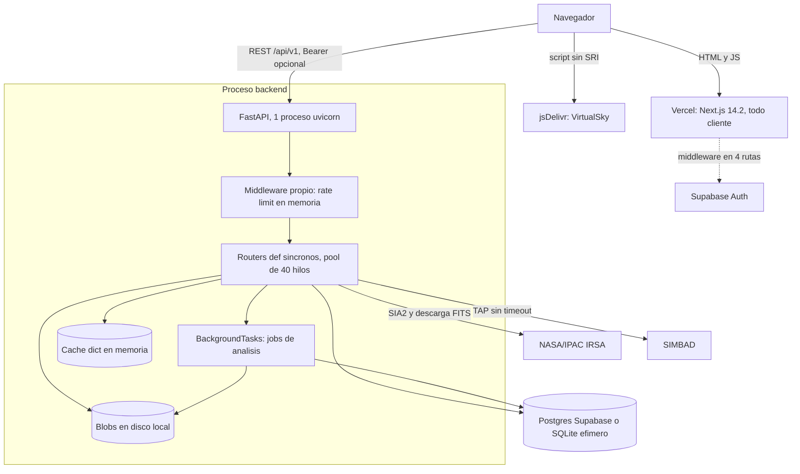
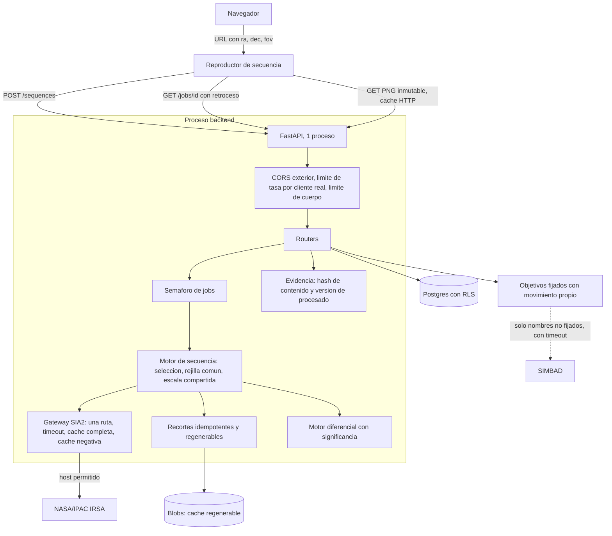

# Auditoría técnica y arquitectónica — The Origin Project

Diagnóstico del repositorio en el commit `8be63e2` (rama `developer`), fechado el
2026-11-11, contrastado contra `docs/challenge.md`. Incluye la especificación de
implementación por paquetes de trabajo y la regla de cambio que debe seguir quien
los ejecute.

**Estado:** diagnóstico pendiente de aprobación. Nada de lo descrito aquí está
implementado.

## 0. Cómo leer este documento

| Si necesitas | Lee |
|---|---|
| Decidir qué se aprueba | §1, §15, §18, §19 |
| Entender por qué se llegó a cada conclusión | §5 a §14 |
| Implementar un cambio (persona o agente) | §20 (regla de cambio) y la ficha del paquete en §21 |
| Las respuestas directas a las once preguntas finales | §22 |

Convenciones usadas en todo el documento:

- **Evidencia** se cita como `ruta:línea` relativa a la raíz del repositorio. Las
  líneas corresponden al commit `8be63e2`; si el archivo cambió, localiza el
  fragmento por su texto.
- **Clase de hallazgo:** `Confirmado` (reproducido o leído sin ambigüedad),
  `Riesgo potencial` (depende de algo no verificado), `Mejora`, `Decisión de
  producto`, `Limitación científica`.
- **Medido** significa observado en una sonda fuera de línea (ASGI en proceso o
  FITS sintéticos). **Lectura** significa deducido del código.
- **Prioridad:** P0 crítico, P1 alto, P2 medio, P3 bajo, con la definición del
  encargo original.

Límites de esta auditoría (detalle en el anexo A): no hubo llamadas a IRSA,
SIMBAD ni Supabase; no se ejecutó la aplicación en un navegador; no se midieron
tamaños de bundle ni métricas web; no se ejecutó ningún escáner de
vulnerabilidades; no se leyó el contenido de `.env` ni de `.env.example`.

---

## 1. Resumen ejecutivo

The Origin Project tiene una base de ingeniería honesta y bien dimensionada (un
monolito FastAPI modular, datos reales de IRSA, sin datos simulados, estados de
error explícitos), pero **hoy no entrega el producto que pide el desafío**. El
enunciado se resume en "coordenadas, secuencia de imágenes como un pequeño video,
cambio visible a simple vista", y esa secuencia no existe.

Los cinco hechos que más pesan:

1. **No hay video.** El botón "Reproducir" solo mueve un borde entre tarjetas de
   texto; ninguna imagen depende del índice de reproducción
   (`frontend/app/time-explorer/page.tsx:72,242`). Requisito R4 sin cumplir.
2. **La variabilidad de brillo es invisible por construcción.** Cada PNG se
   normaliza con sus propios percentiles 1 y 99
   (`backend/app/services/fits_processing.py:172-177`). Medido: la misma estrella
   con flujo 1x y 3x produce píxeles idénticos. Afecta a RW Aurigae y R Draconis.
3. **Los objetivos de movimiento quedan fuera o descentrados.** Solo WISE 0855
   está fijado en código y ninguna posición se propaga por movimiento propio. La
   estrella de Barnard se desplazó unos 4,5 arcmin desde J2000 y el recorte es de
   3 arcmin de radio (`backend/app/services/targets.py:15-22`,
   `frontend/app/time-explorer/page.tsx:101`).
4. **El análisis produce resultados que no son defendibles.** Los candidatos
   creados desde la interfaz se guardan en RA 0, Dec 0
   (`backend/app/routers/analysis.py:69-70`); el centroide declara una medición
   sobre cielo vacío; el "espectro" es un perfil espacial de una sola exposición.
5. **El flujo principal queda detrás de un inicio de sesión** cuando Supabase está
   configurado (`frontend/middleware.ts:17`), lo que rompe R1.

En seguridad no hay hallazgos críticos, pero sí dos altos: el workflow de
despliegue puede ejecutarse con secretos sobre código de un fork
(`.github/workflows/deploy.yml:6-14`) y no hay ninguna política RLS para las
tablas que el backend crea en Supabase (pendiente de comprobar en la base real).

Sobre infraestructura: **no hace falta Redis, DragonflyDB, WebSockets, colas ni
workers** para la escala actual. Los problemas de rendimiento y resiliencia
observados se resuelven con correcciones locales (claves de caché, tiempos
límite, idempotencia de recortes, cabeceras de caché HTTP).

Puntuación de madurez media: **45/100** (detalle en §16). La anterior auditoría
(`docs/auditoria-nasa-space-apps-2026.md`) daba 66/100 y contenía afirmaciones
que hoy se demuestran incorrectas (§13.6).

---

## 2. Arquitectura actual

Monolito modular de dos despliegues:

- **Frontend:** Next.js 14.2 (App Router) en Vercel. Las ocho páginas son
  componentes de cliente; solo `app/layout.tsx` se renderiza en servidor. No hay
  obtención de datos en servidor ni route handlers.
- **Backend:** FastAPI en un único proceso uvicorn, sin `--workers`
  (`backend/Dockerfile:47`, `render.yaml:11`). Todos los handlers son `def`
  síncronos, ejecutados en el pool de hilos (40 por defecto). Los trabajos de
  análisis usan `BackgroundTasks` en el mismo proceso.
- **Persistencia:** SQLAlchemy síncrono. SQLite en disco efímero si
  `DATABASE_URL` queda vacío (`backend/app/config.py:17`); Postgres de Supabase
  en producción según `render.yaml:22-25`. Sin migraciones: `create_all` más
  `_ensure_column` (`backend/app/database.py:57-60`).
- **Caché:** un `dict` en memoria del proceso en Render y Railway; Redis solo en
  `docker-compose.yml`.
- **Blobs (FITS y PNG):** disco local en los tres destinos. El camino S3 no es
  funcional (`backend/app/services/store.py:90,111-112`).

### 2.1 Rutas reales del backend (prefijo `/api/v1`)

| Método | Ruta | Uso desde el frontend |
|---|---|---|
| GET | `/health` | No |
| GET | `/data-sources/status` | Sí, en cada visita a `/` |
| GET, POST | `/targets/resolve` | POST sí; GET no |
| POST | `/observations/search` | Sí |
| GET | `/observations/{id}` | No |
| POST | `/cutouts` | Sí, N llamadas secuenciales |
| GET | `/cutouts/{id}/preview.png` | Sí |
| GET | `/cutouts/{id}/download` | No |
| POST | `/analysis/temporal` | No |
| POST | `/analysis/differential` | Sí |
| POST | `/analysis/spectral` | Sí |
| GET | `/jobs/{id}`, `/jobs/{id}/results`, `/jobs/{id}/artifact/{name}.png` | Sí (sondeo cada 1,5 s) |
| GET | `/candidates` | Sí, desde dos componentes |
| POST | `/research` | Sí |
| GET | `/research/{id}` | Sí |
| GET | `/research/{id}/verify` | No |
| GET | `/evidence/{id}/report` | Sí |
| GET | `/sky/reference-stars` | Sí, en cada montaje |

No existe ningún `PUT` ni `DELETE`.

### 2.2 Flujo frontend/backend del producto principal

1. `POST /targets/resolve` (nombre o par decimal).
2. `POST /observations/search` (cono, hasta cuatro colecciones consultadas en
   serie).
3. El usuario elige a mano dos o más observaciones de una lista de `obs_id`.
4. `POST /cutouts` una vez por observación, en serie y de forma síncrona; cada
   llamada descarga de IRSA aunque el recorte ya exista.
5. El navegador muestra los PNG lado a lado o superpuestos con un control de
   opacidad. No hay animación.
6. Opcional: `POST /analysis/differential`, sondeo de `/jobs/{id}`, resultados.

### 2.3 Flujo de procesamiento científico

1. SIA2 devuelve filas de observación; se persisten con upsert por
   `(obs_id, collection)` sin restricción única.
2. La descarga añade `POS=CIRCLE` a `access_url`; si falla, baja el archivo
   completo sin avisar (`backend/app/routers/cutouts.py:41-46`).
3. `fits_processing` lee las HDU por índice, calcula un resumen y genera un PNG
   con estiramiento por imagen.
4. `temporal` reproyecta B sobre A con `reproject_interp`, iguala la mediana de
   fondo, resta, detecta con `photutils.detect_sources` y calcula un centroide.
5. `spectral` toma la mediana de una tira de 5 píxeles por fila de una sola
   exposición.
6. `evidence` genera un informe con un hash SHA-256 de un subconjunto de campos.

### 2.4 Integraciones externas

| Servicio | Uso | Biblioteca |
|---|---|---|
| NASA/IPAC IRSA SIA2 | Búsqueda de observaciones y descarga de FITS | PyVO (inoperante, ver BE-03) y httpx |
| SIMBAD (CDS) | Resolución de nombres | astroquery 0.4.11 |
| Supabase | Autenticación opcional y Postgres | `@supabase/ssr`, JWT verificado en backend |
| jsDelivr / GitHub raw | Scripts de VirtualSky cargados en la portada | `<script>` sin integridad |
| Vercel, Render, Railway | Despliegue | GitHub Actions |

---

## 3. Stack tecnológico verificado

| Capa | Paquete | Versión resuelta |
|---|---|---|
| Frontend | next | 14.2.35 |
| | react, react-dom | 18.3.1 |
| | three | 0.169.0 |
| | @react-three/fiber / drei | 8.17.10 / 9.114.6 |
| | plotly.js-dist-min | 2.35.2 |
| | framer-motion | 11.11.17 |
| | @supabase/ssr / supabase-js | 0.12.7 / 2.119.0 |
| | typescript | 5.6.3 |
| Backend (venv local) | Python | 3.14.5 (Docker y Render usan 3.12) |
| | fastapi / starlette / uvicorn | 0.120.4 / 0.49.3 / 0.34.3 |
| | astropy | 7.2.3 |
| | photutils / reproject | 2.3.0 / 0.16.0 |
| | pyvo / astroquery | 1.10.0 / 0.4.11 |
| | httpx / pillow / cryptography | 0.28.1 / 11.3.0 / 49.0.0 |

Comprobaciones ejecutadas:

- `npx tsc --noEmit --incremental false`: sin errores.
- `pytest` del backend con base y almacenamiento redirigidos a un directorio
  temporal: **42 pasan, 0 fallan** (la auditoría anterior indicaba 44).

No presentes en el repositorio (verificado en `package.json` y
`requirements.txt`): SWR, TanStack Query, Celery, RQ, boto3, ESLint configurado,
pruebas de frontend, `conftest.py`.

---

## 4. Diagrama de arquitectura actual



---

## 5. Estado del cumplimiento de `docs/challenge.md`

Criterio estricto: la existencia de un archivo no es cumplimiento.

| ID | Requisito | Estado | Evidencia |
|---|---|---|---|
| R1 | Herramienta pública sin barreras | Parcial | `frontend/middleware.ts:17` protege `/time-explorer` si Supabase está configurado; configuración desplegada no verificada |
| R2 | Entrada por RA y Dec | Parcial | `frontend/components/SearchBar.tsx:25-28` solo acepta grados decimales; el formato del propio enunciado se envía a SIMBAD como nombre |
| R3 | Imágenes reales de SPHEREx | No verificable sin red | `backend/app/services/sia2_gateway.py:244-264`; ver BE-03, BE-10, SCI-10 |
| R4 | Secuencia como video | **Falta** | `frontend/app/time-explorer/page.tsx:55,72,242` |
| R5 | Cambio perceptible sin ser experto | **Falta** | Escala por cuadro, cuadros sin alinear, seis interacciones manuales |
| R6 | Barnard's Star | **Falta** | Sin fijar; fuera del recorte por movimiento propio |
| R6 | Epsilon Indi B | No verificable | Depende de SIMBAD en vivo; descentrado unos 2 arcmin |
| R6 | WISE 0855 | Parcial | Fijado; época mal etiquetada; detección exige 5 píxeles sobre 5 sigma |
| R6 | RW Aurigae, R Draconis | **Falta** | Sin escala compartida ni fotometría |
| C1 | Fácil de actualizar con nuevos datos | Parcial | Colecciones en `backend/app/config.py:29`; DOI y colección de sondeo fijos en código |
| C2 | Uso de las 102 bandas, suma por detector | Falta | No existe suma en ningún módulo |
| C3 | Espectros al vuelo | Falta | SCI-06 |
| C4 | Sumar o restar épocas | Parcial | Resta en `backend/app/services/temporal.py:76`; sin suma |
| C5 | Campo de visión configurable | Falta | `size_arcmin: 6` fijo; el control visible es el de la cámara 3D |
| C6 | Superposición Gaia o WISE | Falta | `frontend/components/AladinViewer.tsx` no se importa |
| C7 | Coordenadas en la URL | Falta | Solo `login/page.tsx` lee parámetros de búsqueda |
| C8 | Metadatos y banderas visibles | Parcial | Se calcula `flagged_fraction`; la interfaz no lo muestra |
| C9 | Apoyarse en herramientas públicas | Parcial | Astropy, reproject, photutils; Aladin sin usar |

---

## 6. Auditoría backend

### 6.1 Arquitectura y organización

La arquitectura es adecuada para el tamaño (siete routers, un proceso). **No se
recomienda Clean Architecture, CQRS ni DDD**: no hay un problema observado que
esas capas resuelvan.

Lo que está bien:

- Handlers síncronos declarados como `def` de forma consistente; ningún trabajo
  bloqueante corre en el event loop.
- `Depends(get_db)` y `Depends(get_current_user)` bien usados; configuración
  centralizada con `lru_cache` (`backend/app/config.py:53-55`).
- Degradación honesta: errores por colección como `warnings`, 502 si el archivo
  no responde.
- Dockerfile con usuario no root, healthcheck y `$PORT` dinámico.

Lo que requiere ajuste:

| ID | Hallazgo | Evidencia | Clase |
|---|---|---|---|
| BE-07 | `init_db()` se ejecuta en cada petición y en cada sondeo de job. Medido: 9 sentencias de introspección por llamada | `routers/targets.py:37`, `observations.py:18`, `cutouts.py:32`, `research.py:87`, `services/jobs.py:26,60` | Confirmado |
| BE-12 | `models.py` no define ninguna `ForeignKey` ni `UniqueConstraint`; el upsert de observaciones puede duplicar bajo concurrencia; `GET /targets/resolve` inserta una fila en cada llamada y la tabla nunca se lee | `backend/app/models.py`, `routers/observations.py:48-83` | Confirmado |
| BE-13 | Lógica de persistencia dentro de routers; un job en segundo plano lanza `HTTPException` y el cliente recibe `HTTPException: 404: Cutout ... not found` | `routers/analysis.py:35,52-95` | Mejora |
| BE-06c | La conexión de base queda retenida durante toda la descarga de IRSA | `routers/cutouts.py:33-40` | Confirmado |
| FE-06a | Los 422 devuelven `detail` como lista; el contrato documentado promete texto | `docs/api-contract.md:3` | Confirmado |

Diferencias entre documentación y comportamiento:

| Documento | Afirma | Realidad |
|---|---|---|
| `docs/architecture.md:40-41` | Las descargas FITS corren en jobs | Son síncronas dentro de `POST /cutouts` |
| `docs/architecture.md:26` | Blobs en S3 o disco | S3 no funciona |
| `docs/api-contract.md:22` | Existe `GET /research` | No existe; la lista vive en `localStorage` |
| `docs/api-contract.md:15-16` | `temporal` y `differential` son distintos | Ejecutan la misma función; el segundo carece de RA y Dec |
| `docs/deployment.md:33-35` | MinIO forma parte del stack | Se levanta en compose y nadie lo usa |

### 6.2 Resiliencia y tolerancia a fallos

Tiempos límite reales por integración:

| Llamada | Tiempo límite efectivo | Reintentos |
|---|---|---|
| SIA2 vía PyVO | Ninguno (`sia2_gateway.py:225-229`) | Ninguno |
| SIA2 HTTP de respaldo | 30 s por fase, sin plazo total | Ninguno |
| Descarga FITS | 30 s por fase, sin plazo total; tope de 512 MB en memoria | Ninguno |
| SIMBAD | Ninguno: `Simbad.TIMEOUT` no tiene efecto en astroquery 0.4.11 (`targets.py:74`) | Ninguno |
| JWKS | 10 s | Ninguno |
| Postgres | Sin `connect_timeout` ni `pool_pre_ping` | Ninguno |

Decisión por patrón:

| Patrón | ¿Hace falta? | Motivo y alternativa |
|---|---|---|
| Timeout | **Sí, ahora** | Un IRSA colgado retiene un hilo indefinidamente. Añadir plazo total por llamada |
| Retry | Sí, mínimo | Un reintento con espera aleatoria solo en GET idempotentes y solo ante error de conexión o 502, 503, 504. Nunca ante 4xx |
| Circuit breaker | **No como biblioteca** | Basta una caché negativa de 30 a 60 s del estado "archivo caído". Con IRSA caído, hoy una búsqueda hace hasta 8 peticiones salientes y cada usuario las repite |
| Bulkhead | Sí, mínimo | `max_concurrent_jobs` existe en `config.py:42` y nadie lo usa. Un semáforo lo aplica |
| Rate limiting | Ya existe, mal indexado | Usa `request.client.host`, que detrás de un proxy es la IP del proxy: todos los usuarios compartirían 120 peticiones por minuto, y un usuario sondeando consume 40 (no verificado en producción) |

Otros hallazgos:

- **BE-03 (Confirmado, reproducido por el auditor):** la ruta PyVO pasa
  `(ra, dec, radius_deg, "deg")`; PyVO interpreta cuatro elementos como un rango
  y lanza `ValueError: Invalid ra`. Todas las búsquedas van por el respaldo HTTP,
  registrado solo a nivel INFO (`sia2_gateway.py:229`).
- **BE-04 (Confirmado, medido):** el middleware propio envuelve a
  `CORSMiddleware` (`main.py:39-48`). Las respuestas 429 y 500 salen sin
  cabeceras CORS y el navegador las reporta como error de red. Los preflight
  también consumen cuota.
- **BE-05 (Confirmado, medido):** un reinicio deja filas `running` para siempre
  (`services/jobs.py:44-45`); el frontend espera 10 minutos antes de rendirse.

### 6.3 Idempotencia y consistencia

No se recomienda una cabecera `Idempotency-Key` genérica. Las operaciones tienen
claves naturales.

| Operación | Comportamiento ante duplicado | Mecanismo recomendado |
|---|---|---|
| `POST /cutouts` | Descarga de nuevo y crea otra fila (`cutouts.py:64-76`) | Búsqueda previa por `(observation_id, ra, dec, size, versión de procesado)` y restricción única |
| `POST /analysis/*` | Dos jobs y candidatos duplicados (medido) | Deduplicar por hash de entradas mientras el job esté en cola o en ejecución |
| `POST /observations/search` | Upsert sin restricción única | `UniqueConstraint(obs_id, collection)` y actualizar `access_url` |
| `POST /research` | Dos filas con el mismo hash (medido) | Decisión de producto: permitirlo o unicidad por usuario y hash |
| `GET /targets/resolve` | Inserta una fila por llamada | Un GET no debe escribir; eliminar la escritura |

Inconsistencias observadas entre resultado y registro:

- Candidatos y PNG se confirman en una transacción distinta y anterior a la del
  estado del job (`analysis.py:60,93` frente a `jobs.py:48-54`).
- Filas `Cutout` sobreviven en Postgres y sus blobs no, en cualquier despliegue
  con disco efímero. Medido: el job falla con una traza que expone rutas del
  servidor.
- La sesión de investigación no referencia jobs: puede divergir de lo calculado
  (SCI-07).

### 6.4 Caché y rendimiento del backend

Hoy solo se cachea la respuesta de búsqueda SIA2 (TTL 3600 s).

| ID | Hallazgo | Evidencia | Clase |
|---|---|---|---|
| BE-01a | La clave omite `t_min_mjd`, `t_max_mjd` y `maxrec`. Medido: una segunda búsqueda con otro rango devuelve las filas de la primera | `sia2_gateway.py:155` | Confirmado |
| BE-01b | Un fallo transitorio de una colección queda cacheado una hora como resultado parcial para todos | `sia2_gateway.py:184-194` | Confirmado |
| BE-09a | La caché en memoria no tiene tope y las entradas caducadas solo se borran al releer la misma clave | `services/store.py:13,47-48` | Riesgo potencial |

Qué es determinista y cómo debe cachearse:

| Resultado | Depende de | Política |
|---|---|---|
| Búsqueda SIA2 | RA, Dec, radio, colecciones, rango temporal, `maxrec` | TTL de 1 h con la clave completa; no cachear resultados parciales, o hacerlo 60 s |
| Bytes del recorte FITS | Observación, posición, tamaño | Inmutable. Direccionado por contenido; ya lo es (`cutouts.py:52`) |
| Cuadros PNG | Recortes, parámetros de escala, versión de procesado | Inmutable por clave; servir con `Cache-Control: public, max-age=31536000, immutable` |
| Resultado diferencial | Par de recortes, umbral, versión de procesado | Reutilizable por clave de entrada |
| Resolución de nombre | Nombre normalizado | TTL de días |
| Estado de fuentes de datos | Tiempo | TTL de 30 a 60 s; hoy sondea IRSA en cada visita a `/` |

No se necesita write-through, stale-while-revalidate ni protección contra
estampida con una sola instancia y el tráfico esperado. **Regla obligatoria:**
toda clave que identifique un resultado científico debe incluir todos los
parámetros de entrada y una constante `PROCESSING_VERSION`.

### 6.5 Procesamiento científico y tareas pesadas

- No hay riesgo de bloqueo del event loop: todo el trabajo pesado corre en hilos.
- El cálculo con numpy y reproject compite por el GIL con las peticiones en el
  único proceso. Aceptable a esta escala; añadir procesos rompería la caché y el
  rate limit en memoria.
- La descarga acumula hasta 512 MB en memoria (`sia2_gateway.py:323-332`) y
  Astropy copia a `float64`. En un plan gratuito, un archivo completo puede
  agotar la memoria.
- No hay limpieza de jobs, candidatos, recortes ni blobs.
- **Colas y workers externos: no necesarios.** Basta reconciliar huérfanos al
  arrancar, aplicar el semáforo y convertir la preparación de la secuencia en un
  job con progreso (§9).

---

## 7. Auditoría frontend

### 7.1 Mapa de rutas

| Ruta | Tipo | Dependencias pesadas | Sesión requerida |
|---|---|---|---|
| `/` | Cliente | framer-motion; VirtualSky por CDN | No |
| `/living-sky` | Cliente | three, R3F, drei (carga diferida) | No |
| `/time-explorer` | Cliente | three, R3F, drei (simulador abierto por defecto) | **Sí** |
| `/spectral-lab` | Cliente | plotly (carga diferida al primer resultado) | No en middleware; el backend exige JWT si hay secreto |
| `/discoveries` | Cliente | Ninguna | Sí |
| `/journal`, `/journal/[id]` | Cliente | Ninguna | Sí |
| `/login` | Cliente | supabase | No aplica |

### 7.2 Arquitectura de componentes

| Componente | Líneas | ¿Se usa? | ¿Muestra datos observados? |
|---|---|---|---|
| `CelestialSphere` | 434 | Sí | Sí (huellas, objetivo, candidatos) más estrellas de catálogo |
| `SkyFallback2D` | 82 | Sí, como respaldo | Sí |
| `VirtualSkyViewer` | 215 | Sí, en la portada | **No**: planetario de constelaciones |
| `PlanetSimulator3D` | 194 | Sí, abierto por defecto en Time Explorer | **No**: ilustración procedural |
| `AladinViewer` | 322 | **No (código muerto)** | Sería el único que cubre C6 y C9 |

Hallazgos:

- **FE-04 (Confirmado):** al cambiar de objetivo no se limpian los recortes
  (`components/SearchBar.tsx:32-34`); los del objetivo anterior aparecen en la
  comparación del nuevo. `selected` y `cutouts` no se persisten
  (`lib/store.tsx:63`), así que recargar deja Time Explorer vacío y obliga a
  repetir las descargas.
- **FE-04b (Confirmado):** "Antes" y "Después" siguen el orden de clic, no la
  fecha (`app/time-explorer/page.tsx:66-67,288`).
- **FE-06 (Confirmado):** no existe ningún `error.tsx`, `loading.tsx` ni
  `not-found.tsx`. El `<Canvas>` de `PlanetSimulator3D` no tiene barrera de
  error: un fallo de WebGL en un adorno tumbaría la página completa (no
  verificado en ejecución).
- **FE-06b (Confirmado):** `components/SkyView.tsx:55-56` silencia los fallos y
  borra los candidatos globales.
- **FE-08 (Confirmado):** `CopilotPanel.tsx:47` toma el primer candidato global
  que contenga "moving" y lo presenta como "MEDIDO" de la investigación actual.
  El tutorial describe un color que no corresponde (`Tutorial.tsx:8`).
- `app/time-explorer/page.tsx` (413 líneas) mezcla agrupación de épocas, cola de
  recortes, reproductor, tres vistas, análisis y resultados.

No se recomienda abstraer en general. Las únicas extracciones con un problema
concreto detrás son un hook `useJob` (sondeo cancelable) y la cola de recortes.

### 7.3 Obtención de datos (`frontend/lib/api.ts`)

| ID | Hallazgo | Evidencia | Clase |
|---|---|---|---|
| FE-03a | `NEXT_PUBLIC_API_URL ?? "http://localhost:8000"` no cubre cadena vacía ni valor sin esquema; las peticiones acaban en el propio dominio de Vercel y devuelven HTML | `lib/api.ts:16` | Confirmado |
| FE-03b | Ante un cuerpo no JSON, se muestran hasta 300 caracteres crudos como mensaje de error; origen del HTML visible en producción | `lib/api.ts:51` | Confirmado |
| FE-03c | `res.json()` sin comprobar `content-type` | `lib/api.ts:56` | Confirmado |
| FE-06a | `detail` como lista se muestra como `[object Object]` | `lib/api.ts:48-49` | Confirmado |
| FE-05a | Sondeo a intervalo fijo de 1500 ms, sin retroceso, sin cancelación al desmontar, activo con la pestaña oculta; un error de red aborta y se pierde el `job_id` | `lib/api.ts:113-131` | Confirmado |
| FE-05b | Bucle secuencial de recortes (hasta 8 por 180 s) sin botón de cancelar | `app/time-explorer/page.tsx:90` | Confirmado |
| FE-05c | Condición de carrera: una respuesta del objetivo anterior puede sobrescribir la búsqueda actual | `app/living-sky/page.tsx:26-42` | Riesgo potencial |
| FE-05d | `Content-Type: application/json` en todos los GET fuerza un preflight CORS por petición | `lib/api.ts:38` | Riesgo potencial |

Peticiones duplicadas: `GET /candidates` desde `SkyView.tsx:56` y
`discoveries/page.tsx:32`; `/sky/reference-stars` (catálogo estático) en cada
montaje; `/data-sources/status` en cada visita a `/`.

### 7.4 Renderizado y WebGL

- **FE-07a (Confirmado):** ambos `<Canvas>` omiten `frameloop`, por lo que
  renderizan de forma continua una escena estática
  (`CelestialSphere.tsx:422-431`, `PlanetSimulator3D.tsx:173-177`).
- **FE-07b (Confirmado por geometría, no ejecutado):** "Centrar en la esfera"
  coloca la cámara en la dirección del objetivo mirando al centro, de modo que
  el marcador queda detrás (`CelestialSphere.tsx:316-319`).
- **FE-07c (Confirmado):** `useThree((s) => s.controls)` siempre es nulo porque
  falta `makeDefault` (`CelestialSphere.tsx:302,365`).
- **FE-12 (Riesgo potencial, coste no medido):** un `lineLoop` y un material por
  observación (hasta 250) y una malla por candidato (hasta 200), sin instancing.
- Bien resuelto: geometrías y texturas en `useMemo` con `dispose`; `useFrame` sin
  asignaciones ni `setState`; carga con `next/dynamic` y `ssr: false`; respaldo
  2D con los mismos datos.

No se recomienda memoización adicional. El contexto único re-renderiza a todos
los consumidores (`lib/store.tsx:101`), pero el impacto observado es bajo.

---

## 8. Auditoría SSR y caché

### 8.1 Qué ocurre hoy

Ninguna de las capas de caché de servidor de Next.js interviene, porque no hay
obtención de datos en servidor:

| Capa de Next.js 14.2 | Qué es | ¿Se usa? |
|---|---|---|
| Request memoization | Deduplica `fetch` GET idénticos dentro de un único render de servidor. No persiste entre peticiones | No |
| Data Cache | Caché persistente de `fetch` en servidor; en la versión 14 `fetch` se cachea por defecto | No |
| Full Route Cache | HTML y payload RSC de rutas estáticas | Solo el cascarón estático de cada página |
| Router Cache | Caché en el navegador de segmentos visitados | Sí, de forma implícita |

`"use cache"` y el prerenderizado parcial estable no están disponibles en Next
14; no deben proponerse sin migrar de versión mayor.

### 8.2 Recomendación

**No migrar el flujo principal a Server Components.** Los datos dependen de
coordenadas que elige el usuario, viven en otro origen (FastAPI) y los visores
necesitan APIs del navegador. La ganancia sería marginal y el coste alto.

Lo que sí tiene sentido, por orden de valor:

1. **Estado en la URL (C7).** `?ra=&dec=&fov=` leídos con `useSearchParams`
   dentro de `Suspense`. Es la mejora de arquitectura de frontend con más
   impacto: da enlaces compartibles, elimina la dependencia de `localStorage` y
   permite `generateMetadata` por objetivo.
2. **Cabeceras HTTP de caché en el backend** para recursos inmutables (PNG por
   contenido, catálogo de estrellas de referencia). El navegador hace el resto.
3. **Cascarones estáticos como Server Components** (portada, encabezados): P3,
   ganancia modesta. Antes hay que quitar el `initial={{ opacity: 0 }}` que
   oculta el `<h1>` hasta hidratar (`app/page.tsx:33-36`, efecto no medido).

### 8.3 TanStack Query o SWR

**No necesario ahora.** Los problemas reales (sondeo sin cancelación, dos
lecturas duplicadas, sin deduplicación) se resuelven con un hook `useJob` de
unas 60 líneas y `AbortController`. Incorporar TanStack Query se justifica si
aparece un tercer caso de sondeo o caché compartida; hasta entonces es una
dependencia y un concepto más que mantener.

---

## 9. Evaluación realtime y DragonflyDB

### 9.1 Necesidades reales

| Proceso | Duración | ¿Necesita tiempo real? |
|---|---|---|
| Resolución de objetivo | Corta | No |
| Búsqueda SIA2 | Hasta cuatro consultas en serie | No; basta un indicador |
| Preparación de N recortes | **La más larga del producto** | Necesita progreso por etapa; hoy lo calcula el frontend porque no es un job |
| Análisis diferencial | No medida | Necesita estado; el sondeo actual es suficiente |
| Extracción espectral | No medida | Igual |
| Generación de evidencia | Síncrona | No |

No se midieron duraciones reales (requiere red). El único proceso que justifica
informar progreso es la preparación de la secuencia.

### 9.2 SSE frente a WebSockets

| Criterio | SSE | WebSockets | Sondeo HTTP (actual) |
|---|---|---|---|
| Dirección | Servidor a cliente | Bidireccional | Cliente pregunta |
| ¿La necesita el producto? | Sí encaja | La bidireccionalidad no se usa en ningún flujo | Sí encaja |
| Reconexión | Automática con `Last-Event-ID` | Manual | No aplica |
| Autenticación | `EventSource` no envía `Authorization` | Requiere protocolo propio | Ya resuelta |
| Coste en este backend | Un hilo retenido por conexión si el handler es síncrono; exigiría un endpoint `async` | Mayor | Una consulta por intervalo |
| Varias instancias | El estado debe estar en la base | Requiere pub/sub | La base ya es la fuente de verdad |

**Decisión:** WebSockets, no. SSE, **todavía no**. Primero hay que corregir lo
que hace insuficiente el sondeo: el job no expone progreso
(`backend/app/schemas.py:132-138`), cada sondeo ejecuta `init_db()`, y el cliente
no retrocede ni cancela. Con esos tres arreglos, sondear cada 1 a 2 segundos es
adecuado.

Criterio para incorporar SSE después: que la preparación de la secuencia supere
de forma habitual los 20 segundos y el sondeo con progreso por etapa resulte
tosco en pruebas con usuarios.

Flujo de referencia, válido tanto para sondeo como para SSE:

1. El frontend envía `POST /api/v1/sequences` con RA, Dec y tamaño.
2. El backend deduplica por clave de entrada, crea o reutiliza el job y devuelve
   `job_id`.
3. El job se ejecuta bajo el semáforo y actualiza en la base
   `stage`, `done` y `total`.
4. El frontend consulta `GET /jobs/{id}` con retroceso (o se suscribe a
   `GET /jobs/{id}/events` si se adopta SSE).
5. Cada evento o respuesta lleva el estado completo, no un incremento.
6. Al terminar, el resultado queda en `GET /jobs/{id}/results`.
7. Tras una desconexión, el cliente vuelve al paso 4 con el `job_id` guardado en
   la URL. Como el estado vive en la base, no se pierde nada.

Si se adopta SSE: endpoint `async` que lea la base una vez por segundo, sin
pub/sub; el identificador del job no sirve hoy como credencial porque
`/candidates` lo publica (SEC-10); limitar conexiones con `--limit-concurrency`.

### 9.3 Redis, DragonflyDB o nada

| Uso posible | ¿Lo necesita The Origin hoy? |
|---|---|
| Caché distribuida | No: una sola instancia |
| Pub/Sub para SSE | No: la base es la fuente de verdad |
| Broker de tareas | No: no hay workers |
| Estado compartido entre instancias | No hay varias instancias |
| Rate limiting distribuido | No con una instancia |
| Sesiones | No: JWT sin estado |

Comparación:

| | Sin almacén externo | Redis o Valkey | DragonflyDB |
|---|---|---|---|
| Coste operativo | Ninguno | Un servicio más | Un servicio más |
| Licencia | No aplica | Redis 8: AGPLv3 entre otras; Valkey: BSD | BSL 1.1, código disponible pero no abierto |
| Compatibilidad | No aplica | Referencia | Alta con carencias en módulos y algunos comandos |
| Ventaja diferencial | Simplicidad | Ecosistema y oferta gestionada | Rendimiento multihilo a gran escala |
| Encaje aquí | **Correcto** | Correcto si se escala a varias instancias | Su ventaja no aplica a este tamaño |

Los datos de licencia proceden de fuentes secundarias consultadas el 2026-11-11;
confirmar en la licencia oficial antes de adoptar cualquiera.

**Recomendación: mantener la arquitectura actual sin almacén externo.** El
cliente Redis opcional ya existe en `services/store.py` y puede quedarse.
Incorporar Redis o Valkey gestionado solo cuando se necesite una segunda
instancia del backend. DragonflyDB no se recomienda: resuelve un problema de
rendimiento que el proyecto no tiene, y no es una cola duradera.

---

## 10. Auditoría de seguridad

Resumen: 0 críticos, 2 altos, 6 medios, 6 bajos. No se ejecutó `npm audit` ni
`pip-audit`.

| ID | Título | Clase | Severidad | Probabilidad |
|---|---|---|---|---|
| SEC-01 | El despliegue puede ejecutarse con secretos sobre código de un fork | Confirmado en configuración; no explotado | Alta | Media |
| SEC-02 | Tablas creadas por SQLAlchemy en Supabase sin RLS | Riesgo potencial | Alta | Media |
| SEC-03 | Redirección abierta en `/login?next=` | Confirmado por lectura | Media | Media |
| SEC-04 | Rate limit indexado por la IP del proxy | Confirmado en código | Media | Alta |
| SEC-05 | `collections` sin límite; caché sin tope y manipulable | Confirmado | Media | Alta |
| SEC-06 | `POST /research` sin límites de tamaño | Confirmado, medido | Media | Media |
| SEC-07 | Jobs sin tope; descarga de 512 MB en memoria | Confirmado | Media | Media |
| SEC-08 | Descarga sin lista de hosts permitidos y con redirecciones | Riesgo potencial | Media | Baja |
| SEC-09 | Inyección de fórmulas en el CSV de evidencia | Confirmado | Baja | Baja |
| SEC-10 | Jobs sin propietario; `/candidates` publica `job_id` y `user_id` | Confirmado | Baja | Alta |
| SEC-11 | Scripts de terceros sin integridad y con referencias mutables | Riesgo potencial | Baja | Baja |
| SEC-12 | JWT sin validar `aud` ni `iss`; autenticación todo o nada | Endurecimiento | Baja | Baja |
| SEC-13 | Sin cabeceras de seguridad; `/docs` expuesto; errores con detalle interno | Endurecimiento | Baja | Media |
| SEC-14 | Compose con puertos en todas las interfaces; dependencias sin lock | Endurecimiento | Baja | Baja |

Detalle de los dos altos:

**SEC-01.** `.github/workflows/deploy.yml:6-9` se dispara con `workflow_run`
filtrado por `branches: [main]`, y los jobs solo comprueban
`conclusion == 'success'` (`:14`, `:44`). Ese filtro compara el nombre de la
rama de origen, que en un fork puede llamarse `main`. El workflow hace checkout
de `workflow_run.head_sha` y usa `VERCEL_TOKEN` y `SUPABASE_DB_PASSWORD`. El
comentario "Never triggered by pull requests" es incorrecto. Condiciones no
verificadas: que el repositorio sea público y la política de aprobación de CI
para colaboradores nuevos.

**SEC-02.** `backend/app/database.py:57` crea las tablas con `create_all` y el
repositorio no contiene ninguna sentencia RLS. Si el proyecto de Supabase
conserva los permisos por defecto del rol `anon` sobre el esquema `public`,
cualquiera con la clave pública podría leer y escribir esas tablas por la API
REST de Supabase. Eso encadenaría con dos debilidades confirmadas: `access_url`
se descarga sin validar el host (`routers/cutouts.py:38-44`) y `storage_get`
acepta rutas absolutas (`services/store.py:113`). **Hay que comprobarlo en la
base real** con:

```sql
select relname, relrowsecurity
from pg_class
where relnamespace = 'public'::regnamespace and relkind = 'r';
```

Controles verificados como correctos: solo ORM, sin SQL crudo; astroquery escapa
las comillas del nombre; claves de almacenamiento generadas en servidor; JWT con
algoritmo fijado, `none` rechazado y `exp` obligatorio; CORS con lista explícita
y sin credenciales; sin `dangerouslySetInnerHTML`; solo tres variables
`NEXT_PUBLIC_*` y ninguna sensible; `.env` ignorado y nunca versionado; backend
en Docker con usuario no root.

Realtime: ver los cinco hechos de §9.2.

---

## 11. Auditoría de rendimiento

**Nada de esta sección está medido en producción.** No se midieron LCP, INP,
CLS, TTFB, First Load JS ni tiempos de hidratación: `frontend/.next` es una
compilación de desarrollo y no se ejecutó `next build`. Lo que sigue son causas
estructurales leídas en el código.

Cuellos de botella probables, por impacto en "tiempo hasta el primer video":

| # | Causa | Evidencia | Arreglo |
|---|---|---|---|
| 1 | Cada recorte se vuelve a descargar de IRSA en cada visita | `routers/cutouts.py:64-76`, `lib/store.tsx:63` | Idempotencia de recortes |
| 2 | Recortes en serie desde el navegador, uno por petición | `app/time-explorer/page.tsx:90` | Job de secuencia con concurrencia acotada en servidor |
| 3 | Hasta cuatro colecciones consultadas en serie, dos intentos cada una | `sia2_gateway.py:169-173,207-211` | Arreglar la ruta primaria; no reintentar ante 4xx |
| 4 | PNG servidos sin `Cache-Control` | `routers/cutouts.py:96` | Cabecera inmutable |
| 5 | Cada sondeo ejecuta 10 sentencias para leer una fila | BE-07 | Quitar `init_db()` de las peticiones |
| 6 | Render WebGL continuo de escenas estáticas | FE-07a | `frameloop="demand"` |
| 7 | Simulador 3D decorativo cargado por defecto en la ruta principal | `app/time-explorer/page.tsx:213` | Retirarlo o cargarlo bajo demanda |
| 8 | framer-motion y supabase en todas las rutas | `components/Tutorial.tsx:4`, `lib/api.ts:14` | P3, medir primero |

Infraestructura:

| Componente | ¿Necesario? | Motivo |
|---|---|---|
| Redis o DragonflyDB | No | §9.3 |
| Workers y colas | No | §6.5 |
| Almacenamiento de objetos | **Decisión pendiente** | Los blobs en disco efímero divergen de la base. Alternativa sin infraestructura: tratar el blob como caché regenerable |
| CDN | No | Vercel ya sirve el frontend; los PNG son pequeños |
| Caché HTTP | **Sí** | Barato y de alto impacto |
| Compresión | Sí, barata | `GZipMiddleware` para listas de hasta 800 observaciones |
| Procesamiento asíncrono | Ya existe | Extenderlo a la secuencia |
| Escalado horizontal | No | Rompería caché y rate limit en memoria sin beneficio medido |

Antes de optimizar más: registrar duración por etapa (búsqueda, descarga,
reproyección, render) y ejecutar `next build` para leer First Load JS por ruta.

---

## 12. Evaluación UX

Flujo real desde la portada hasta ver algo comparable: unas seis interacciones y
dos esperas largas.

1. Escribir el objetivo y pulsar Enter.
2. Esperar resolución y búsqueda; redirección a `/living-sky`.
3. Elegir a mano dos o más observaciones de una lista de `obs_id`.
4. Pulsar "Iniciar investigación temporal"; inicio de sesión si Supabase está
   activo.
5. Pulsar "Preparar recortes" y esperar la descarga en serie.
6. No hay video: superposición con control manual o análisis diferencial.

Esto contradice la regla "cero pasos previos obligatorios" de
`docs/challenge.md`.

¿Puede el usuario entender lo que ve?

| Pregunta | Estado |
|---|---|
| Qué datos observa | Parcial: lista de identificadores sin explicar |
| De dónde provienen | Bien: colección y `queried_at` visibles |
| A qué época corresponden | Parcial: fecha en un desplegable; "Antes" y "Después" pueden estar invertidos |
| Qué procesamiento se hizo | Deficiente: sin indicador de escala; métodos declarados aunque no se ejecuten |
| Qué es observación y qué inferencia | Parcial: existen las etiquetas, pero "MEDIDO" se aplica a frases que no son mediciones |
| Qué limitaciones tiene | Bien: las limitaciones del backend se muestran |
| Cómo reproducirlo | Deficiente: sin URL con coordenadas; el hash cubre muy poco |

Otros hallazgos:

- **UX-05 (Confirmado):** mezcla de inglés y español con `<html lang="es">`;
  marca inconsistente ("ASTRA TRACE", "ASTRA Copilot", "THE ORIGIN PROJECT");
  dos botones de la portada con el mismo destino (`app/page.tsx:58`).
- **UX-05b (Confirmado):** el menú "Discoveries" lista candidatos, y
  `login/page.tsx:71` promete "tus descubrimientos". El texto correcto ya existe
  en otro punto: "candidato por validar, no un descubrimiento".
- **FE-09 (Confirmado):** en 375 px de ancho el visor queda sin espacio
  (`living-sky/page.tsx:53`); 59 usos de texto de 10 u 11 px; diálogo del
  tutorial sin gestión de foco ni tecla Escape; lienzos sin `aria-label`.
- Bien resuelto: estados vacíos y de error honestos, botones de acceso a los
  cinco objetivos, exportación CSV.

---

## 13. Validación científica

### 13.1 Qué es cada resultado hoy

| Categoría | Ejemplos en el sistema | ¿Correctamente etiquetado? |
|---|---|---|
| Observación directa | Recorte FITS, PNG de previsualización | Sí en origen; el PNG no indica su escala |
| Resultado calculado | Imagen de diferencia, SNR de detección | Sí, con limitaciones |
| Candidato | "possible candidate (unclassified)", "possible moving source" | **No**: se crea sin prueba de significancia y en coordenadas (0, 0) |
| Hipótesis | Etiqueta "INFERENCIA" en el panel | Parcial |
| Descubrimiento confirmado | No se afirma en los resultados | Se sugiere en el nombre "Discoveries" y en el texto de inicio de sesión |

### 13.2 Hallazgos que comprometen la validez

| ID | Hallazgo | Evidencia | Clase |
|---|---|---|---|
| SCI-01 | Estiramiento por percentiles 1 y 99 de cada imagen. Medido: flujo 1x y 3x producen el mismo valor de píxel | `fits_processing.py:172-177`, `temporal.py:198-201` | Confirmado |
| SCI-02 | Los PNG no se reproyectan a una rejilla común ni se orientan; cada exposición tiene su propio apuntado, de modo que alternarlos mostraría saltos de apuntado, no movimiento del objeto | `fits_processing.py:180` | Confirmado |
| SCI-03 | Solo WISE 0855 está fijado; sin movimiento propio en todo el backend; `"epoch": "J2000"` fijo. La posición de WISE 0855 del enunciado no es de época 2000,0: se confunde equinoccio con época | `targets.py:15-22,46-47` | Confirmado |
| SCI-04 | Los candidatos se guardan en (0, 0) y comparten una coordenada en lugar de su centroide. Se crea "possible moving source" siempre que `measured` sea verdadero, sin comparar separación con error | `analysis.py:69-70,79-92` | Confirmado |
| SCI-05 | Centroide ponderado sobre 13 por 13 píxeles con error igual a la escala de píxel. Medido en 200 ensayos: movimiento real de 10,4 arcsec se recupera como 7,5 (SNR 50) o 4,1 (SNR 10); **cielo vacío da `measured: True` y 4,5 arcsec** | `temporal.py:271,298,306-317` | Confirmado |
| SCI-06 | El motor espectral lee `hdul[5]` como tabla de longitudes de onda, pero el propio módulo documenta IMAGE en 1 y WCS-WAVE en 6: los índices usados (1 y 5) no son coherentes entre sí. Además, lo calculado es la mediana por fila de una sola exposición: un perfil espacial, no el espectro del objeto | `spectral.py:67-71,89-95,122-143`, `fits_processing.py:3-4,132-135` | Confirmado (incoherencia); layout real por verificar |
| SCI-07 | El hash de evidencia cubre nombre, coordenadas e identificadores. Medido: cambiar SNR, mediciones, banda o título no altera el hash y el informe sigue diciendo "MATCH - content agrees". El diario guarda candidatos globales y métodos fijos aunque no se haya ejecutado nada | `evidence.py:47-54,144`, `journal/page.tsx:57-69` | Confirmado |
| SCI-08 | La detección solo ve residuos positivos y exige 5 píxeles sobre 5 sigma. Medido: un pico de 15 sigma se detecta 0 de 50 veces | `temporal.py:225,234` | Confirmado |
| SCI-09 | Banda distinta solo añade una advertencia; la guarda de detector no se activa si los campos están vacíos; la selección de cuadros es manual | `temporal.py:47,54-58`, `lib/store.tsx:82` | Confirmado |
| SCI-10 | Supuestos no verificados contra datos reales: nombres de columnas de SIA2, semántica de `POS` en la URL de recorte, significado de los bits de FLAGS, layout de extensiones | `sia2_gateway.py:34-37`, `cutouts.py:20-27`, `fits_processing.py:70-71` | Riesgo potencial |
| SCI-11 | Sin igualación de PSF ni de escala de flujo; con medio píxel de desfase el umbral nominal de 5 sigma equivale a unos 6,4 | `temporal.py:62-64,150` | Limitación científica |

### 13.3 Limitación de fondo que condiciona el diseño del video

Cada exposición de SPHEREx observa un punto del cielo en una longitud de onda
que depende de su posición en el detector. Por tanto:

- Una secuencia de la **misma banda** en un punto dado tiene pocas épocas (del
  orden de una por barrido semestral fuera de los campos profundos).
- Una secuencia con **muchos cuadros** mezcla longitudes de onda: el brillo
  cambia por el espectro del objeto, no por variabilidad.

Consecuencia de diseño: se necesitan dos modos explícitos, no uno.

| Modo | Cuadros | Escala | Sirve para |
|---|---|---|---|
| Movimiento | Todas las exposiciones de un detector, ordenadas por fecha, con la longitud de onda rotulada | Significancia sobre el fondo, con rango fijo; rotulada como no comparable en brillo | Barnard's Star, Epsilon Indi B, WISE 0855 |
| Brillo | Solo exposiciones con la misma longitud de onda en la posición del objetivo, dentro de una tolerancia | Física y compartida por toda la secuencia, con barra de escala | RW Aurigae, R Draconis |

Esta propuesta no está validada con datos reales; la tolerancia y el número de
cuadros resultante son la decisión D5 de §19.

### 13.4 Objetivos de prueba

| Objetivo | Resolución hoy | Problema |
|---|---|---|
| WISE 0855 | Fijado, coincide con el enunciado | Unos 2 arcmin de desplazamiento sin corregir; fuente débil frente al criterio de detección |
| Barnard's Star | Solo SIMBAD | Unos 4,5 arcmin desde J2000: fuera del recorte de 3 arcmin de radio |
| Epsilon Indi B | Solo SIMBAD | Unos 2 arcmin descentrado |
| RW Aurigae | Solo SIMBAD | Sin escala compartida ni fotometría |
| R Draconis | Solo SIMBAD | Igual; posible truncamiento de la lista en zonas de alta cadencia (no verificado) |

### 13.5 Lo que está bien hecho

- No se simulan datos y las limitaciones viajan con cada resultado.
- Reproyección WCS real con un respaldo rotulado como no astrométrico.
- Varianza y banderas se usan cuando existen; el recorte guarda su SHA-256 y su
  URL de origen.
- El hash declara lo que cubre y que no es a prueba de manipulación.

### 13.6 Correcciones a la auditoría anterior

| Afirmación de `auditoria-nasa-space-apps-2026.md` | Estado |
|---|---|
| "Play/pause real entre épocas" y "Blink + slider: COMPLETO" | **Incorrecta**: no hay reproducción ni parpadeo |
| "Detectores: COMPLETO" | Sobreestimada (SCI-09) |
| "Extracción real por fila vía WCS-WAVE" | **Incorrecta** bajo el layout del propio código (SCI-06) |
| "44/44 tests" | Hoy son 42 |
| "WISE 0855 correcto a menos de 0,001 arcsec" | La conversión es correcta; omite época y movimiento propio |
| "Hash SHA-256 verificable" | Cierto, con cobertura mínima (SCI-07) |
| Cuatro de cinco objetivos no resuelven; sin PSF; sin suma; Aladin muerto; recorte fijo; sin URL; sin sexagesimal | Vigentes |
| Sus tres P0 | Ninguno implementado |

---

## 14. Auditoría de pruebas

| Archivo | Pruebas | Qué comprueban | Tipo |
|---|---|---|---|
| `test_api.py` | 6 | Salud, eco de coordenadas, WISE fijado, dos 422 | Contrato |
| `test_auth.py`, `test_auth_tokens.py` | 16 | JWT y `user_id` | Contrato |
| `test_cutouts_direct.py` | 1 | Descarga simulada | Contrato |
| `test_evidence_direct.py` | 7 | Tipo de contenido, nombre de archivo, cabecera PDF | Humo y contrato |
| `test_fits_synthetic.py` | 3 | Dos HDU, máximo, cabecera PNG | Humo |
| `test_research_integrity.py` | 5 | Registro y orden del hash | Contrato |
| `test_sia2.py` | 4 | Parámetros y normalización | Contrato |

**Pruebas que validen ciencia con una verdad inyectada: ninguna.** Una prueba
que comprueba que el código se ejecuta no valida el resultado.

Funciones críticas sin ninguna prueba directa:

- `TemporalAnalysisEngine.compare`, `_align`, `_detect`, `_astrometry`,
  `_centroid`.
- `SpectralAnalysisEngine.extract`, `_wavelength_axis`, `_aperture_profile`.
- `FITSProcessingService.load_science_arrays`, ramas de FLAGS y VARIANCE.
- `TargetResolutionService._resolve_simbad`.
- `SPHERExDataGateway.search`, `_query_pyvo`, `_query_http`, `download`.
- `jobs.run_job`, `observations._upsert`, `cutouts._cutout_url`.

Problemas de la propia suite:

- **TST-01 (Confirmado):** no hay `conftest.py`. Las pruebas escriben en la base
  que indique `DATABASE_URL`; si el `.env` de la raíz apunta a producción,
  `pytest` escribiría allí. La base local ya contiene restos de ejecuciones
  anteriores.
- CI ejecuta `pytest` y `tsc` solo en push o PR a `main`. Sin lint, sin `next
  build`, sin pruebas de frontend.

Qué tipo de dato necesita cada prueba futura:

| Dato | Para qué |
|---|---|
| FITS sintéticos con fuente inyectada | Recuperación de desplazamiento y caso nulo; cambio de flujo en ambos signos; ruido puro; píxeles con bandera; escala compartida; layout de extensiones |
| Datos reales de SPHEREx grabados una vez | Nombres de extensión, bits de FLAGS, estructura de WCS-WAVE, columnas de SIA2, semántica del recorte |
| Simulacros | SIMBAD, `httpx.MockTransport` para caché, respaldo y errores; ciclo de jobs |

---

## 15. Matriz de hallazgos priorizados

> **Actualización tras WP-05 (2026-11-11).** Con datos reales de IRSA cambió el
> estado de varios hallazgos. Detalle, evidencia y los hallazgos nuevos
> (DAT-01 a DAT-14) están en
> [auditoria-nasa-space-apps-2026.md](auditoria-nasa-space-apps-2026.md) §15.
>
> | Hallazgo | Antes | Ahora |
> |---|---|---|
> | BE-03 (ruta PyVO) | Confirmado | Sigue; además el respaldo HTTP no mapea detector, banda ni fecha (DAT-02) |
> | SCI-10 (supuestos sin verificar) | Riesgo potencial | **Verificado**: la URL de recorte de la app es rechazada con HTTP 422 y se baja el archivo completo (DAT-01); `POS` no se honra, se rechaza |
> | SCI-06 (espectro) | Confirmado (incoherencia de índices) | **Confirmado con datos reales**: `hdul[5]` es la PSF; `WCS-WAVE` es el índice 6 y es una rejilla 9×9 (DAT-04, DAT-07) |
> | H15/SCI-09 (detector vacío) | Riesgo potencial | **Confirmado**: la respuesta no tiene `detector`, `band` ni `date_obs` (DAT-02) |
> | Observaciones duplicadas por `obs_id` | Riesgo potencial alto | **Confirmado**: un `obs_id` agrupa hasta 6 productos (DAT-03) |
> | H20 (`FLAGS == 0`) | Riesgo potencial | **Confirmado**: 0 % de píxeles válidos en Barnard y R Draconis (DAT-05) |
> | BE-10/H18 (truncamiento) | Riesgo potencial | **Confirmado**: R Draconis suma más de 2500 filas (DAT-08) |
> | SCI-05/SCI-08 (motores) | Confirmado con sintéticos | Además **fallan con datos reales** (DAT-04) |

La solución propuesta y las pruebas de cada hallazgo están en la ficha del
paquete de trabajo indicado en la columna WP (§21). Complejidad y riesgo de
cambio: B baja, M media, A alta.

### P0 — Crítico

| ID | Área | Hallazgo | Evidencia | Impacto | Clase | Compl. | Riesgo | WP |
|---|---|---|---|---|---|---|---|---|
| FE-01 | Frontend, ciencia | No existe la secuencia tipo video | `frontend/app/time-explorer/page.tsx:72,242` | R4 sin cumplir: el producto no existe | Confirmado | A | M | 10, 11 |
| SCI-01 | Ciencia | Escala de intensidad por cuadro | `backend/app/services/fits_processing.py:172-177` | Variabilidad invisible (dos objetivos) | Confirmado | M | M | 10 |
| SCI-02 | Ciencia | Cuadros sin rejilla común ni orientación | `fits_processing.py:180` | Un video mostraría saltos de apuntado | Confirmado | M | M | 10 |
| SCI-03 | Ciencia | Objetivos sin fijar ni propagar por movimiento propio | `backend/app/services/targets.py:15-22,46-47` | Barnard fuera del recorte; cuatro objetivos dependen de SIMBAD en vivo | Confirmado | M | B | 06 |
| SCI-04 | Ciencia, backend | Candidatos en (0, 0) y etiqueta de movimiento sin prueba de significancia | `backend/app/routers/analysis.py:69-70,79-92` | Datos inventados en la base y en los informes | Confirmado | M | M | 12 |
| SCI-05 | Ciencia | Astrometría de centroide no defendible | `backend/app/services/temporal.py:271,298,306-317` | Declara mediciones sobre ruido | Confirmado | M | M | 12 |
| SCI-06 | Ciencia | El "espectro" no es un espectro; índice de extensión incoherente | `backend/app/services/spectral.py:67-71,122-143` | Afirmación científica falsa en la interfaz | Confirmado | B a A | M | 13 |
| SCI-07 | Ciencia | Evidencia: hash de cobertura mínima, métodos fijos, candidatos ajenos | `backend/app/services/evidence.py:47-54,144` | El diferenciador del proyecto no garantiza lo que afirma | Confirmado | M | A | 14 |
| FE-02 | Frontend, seguridad | Inicio de sesión en el flujo principal | `frontend/middleware.ts:17`, `backend/app/auth.py:161-166` | R1 sin cumplir | Confirmado | B | A | 04 |
| FE-03 | Frontend | URL base sin validar; HTML crudo como error | `frontend/lib/api.ts:16,51,56` | Sitio en producción sin datos | Confirmado | B | B | 03 |
| BE-01 | Backend | Clave de caché incompleta; parciales cacheados una hora | `backend/app/services/sia2_gateway.py:155,184-194` | Resultados incorrectos servidos a todos | Confirmado | B | B | 07 |
| SEC-01 | Seguridad | Despliegue con secretos sobre código de un fork | `.github/workflows/deploy.yml:6-14` | Robo de token y SQL arbitrario | Confirmado | B | M | 01 |
| SEC-02 | Seguridad | Tablas sin RLS; lectura de rutas absolutas | `backend/app/database.py:57`, `backend/app/services/store.py:113` | Lectura y escritura anónima de la base | Riesgo potencial | B | M | 02 |

### P1 — Alto

| ID | Área | Hallazgo | Evidencia | Impacto | Clase | Compl. | Riesgo | WP |
|---|---|---|---|---|---|---|---|---|
| BE-02 | Backend | Sin tiempo límite en SIA2 por PyVO ni en SIMBAD | `sia2_gateway.py:225-229`, `targets.py:74` | Un servicio colgado retiene hilos sin fin | Confirmado | B | B | 06, 07 |
| BE-03 | Backend | La ruta PyVO siempre falla | `sia2_gateway.py:229` | Doble petición por búsqueda; ruta primaria muerta | Confirmado | B | B | 07 |
| BE-04 | Backend | Middleware propio envuelve a CORS | `backend/app/main.py:39-48` | 429 y 500 se ven como "Backend unreachable" | Confirmado | B | B | 15 |
| BE-05 | Backend | Jobs huérfanos; `max_concurrent_jobs` sin efecto | `backend/app/services/jobs.py:44-45`, `config.py:42` | Esperas de 10 minutos; sin tope de carga | Confirmado | M | M | 09 |
| BE-06 | Backend | `POST /cutouts` no es idempotente; retiene la conexión; cae al archivo completo | `backend/app/routers/cutouts.py:33-46,64-76` | Mayor coste de tiempo hasta el primer video | Confirmado | M | M | 08 |
| BE-07 | Backend | `init_db()` en cada petición | `routers/*.py`, `services/jobs.py:26,60` | 10 sentencias por sondeo | Confirmado | B | B | 09 |
| BE-08 | Backend | Rate limit por IP del proxy | `main.py:50-60` | Cubeta compartida por todos los usuarios | Confirmado en código | B | M | 15 |
| BE-09 | Backend | Entradas sin límite: `collections`, cuerpo de `/research`, `limit`, rangos RA y Dec; caché sin tope | `backend/app/schemas.py:46-50,69,152-166,184-189` | Amplificación sobre IRSA; agotamiento de memoria | Confirmado | B | B | 06, 07, 14, 15 |
| BE-10 | Backend, ciencia | Mapeo de columnas SIA2 incompleto; sin deduplicar; truncamiento sin aviso | `sia2_gateway.py:34-37,178-179` | Detector, banda y fecha podrían quedar vacíos | Riesgo potencial | B | B | 05, 07 |
| SCI-08 | Ciencia | Detección solo positiva y con 5 píxeles mínimos | `temporal.py:225,234` | Pierde fuentes puntuales y atenuaciones | Confirmado | B | M | 12 |
| SCI-09 | Ciencia | Misma banda y detector no garantizados; orden no cronológico | `temporal.py:47,54-58`, `time-explorer/page.tsx:66-67` | Comparaciones no honestas | Confirmado | M | M | 10, 12 |
| SCI-10 | Ciencia | Supuestos sin verificar contra datos reales | `cutouts.py:20-27`, `fits_processing.py:70-71` | Todo el procesado descansa en ellos | Riesgo potencial | M | B | 05 |
| FE-04 | Frontend | Estado incoherente al cambiar de objetivo; nada persiste | `frontend/components/SearchBar.tsx:32-34`, `frontend/lib/store.tsx:63` | Recortes de otro objetivo en la comparación | Confirmado | B | B | 11 |
| FE-05 | Frontend | Sondeo frágil; recortes en serie sin cancelar | `frontend/lib/api.ts:113-131` | Trabajo perdido ante un error de red | Confirmado | M | B | 11 |
| FE-06 | Frontend | Sin `error.tsx`; errores silenciados; `[object Object]` | `frontend/components/SkyView.tsx:55-56`, `lib/api.ts:48-49` | Fallos invisibles o ilegibles | Confirmado | B | B | 03, 17 |
| UX-01 | UX | Sin formato sexagesimal | `SearchBar.tsx:25-28` | El formato del enunciado no funciona | Confirmado | B | B | 06 |
| UX-02 | UX | Sin coordenadas en la URL | Ninguna ruta lee parámetros | C7 sin cumplir; nada es compartible | Confirmado | M | B | 11 |
| UX-03 | UX | Campo de visión fijo | `time-explorer/page.tsx:101` | C5 sin cumplir; objetos rápidos fuera de cuadro | Confirmado | B | B | 11 |
| UX-04 | UX | Seis interacciones hasta ver algo | §12 | R5 sin cumplir | Confirmado | M | M | 11 |
| UX-05 | UX | Idiomas mezclados; "Discoveries" para candidatos | `frontend/app/page.tsx:41-67`, `Sidebar.tsx:16-21` | Confusión y pérdida de credibilidad | Confirmado | B | B | 17 |
| SEC-03 | Seguridad | Redirección abierta en login | `frontend/app/login/page.tsx:13,55` | Suplantación tras un inicio de sesión legítimo | Confirmado | B | B | 16 |
| TST-01 | Pruebas | La suite escribe en la base configurada | `backend/tests/` sin `conftest.py` | Riesgo de escribir en producción | Confirmado | B | B | 00 |
| TST-02 | Pruebas | Cero pruebas científicas con verdad inyectada | §14 | Regresiones científicas indetectables | Confirmado | M | B | 10, 12, 13 |
| INF-01 | Infraestructura | Blobs y SQLite en disco efímero | `config.py:17`, `docs/deployment.md:85-86` | Filas que apuntan a archivos inexistentes | Confirmado | M | M | 08 |

### P2 — Medio

| ID | Área | Hallazgo | Evidencia | Compl. | Riesgo | WP |
|---|---|---|---|---|---|---|
| SCI-11 | Ciencia | Sin suma de épocas ni de detectores (C2, C4); sin igualación de PSF | `temporal.py:62-64,76` | A | M | 20 |
| UX-06 | UX | Sin superposición Gaia o WISE (C6, C9); visores decorativos en el flujo principal | `AladinViewer.tsx` sin importar; `VirtualSkyViewer`, `PlanetSimulator3D` | M | M | 18 |
| UX-07 | UX | Metadatos y banderas calculados pero no mostrados (C8) | `frontend/lib/types.ts:69` | B | B | 19 |
| FE-07 | Frontend | Render continuo; centrado invertido; `makeDefault` ausente | `CelestialSphere.tsx:302,316-319,422-431` | B | B | 21 |
| FE-08 | Frontend | Texto engañoso y código muerto | `CopilotPanel.tsx:47`, `Tutorial.tsx:8`, `lib/api.ts:63,75,85` | B | B | 17 |
| FE-09 | Frontend, UX | Diseño no adaptable; accesibilidad | `living-sky/page.tsx:53`, `Tutorial.tsx:40` | M | B | 17 |
| FE-10 | Frontend | Imágenes sin dimensiones ni precarga; PNG sin `Cache-Control` | `time-explorer/page.tsx:307-346`, `cutouts.py:96` | B | B | 08, 11 |
| BE-11 | Backend | El log no incluye el identificador de petición; `/health` estático | `main.py:73`, `routers/system.py:12-14` | B | B | 22 |
| BE-12 | Backend | Sin restricciones únicas ni claves foráneas; un GET escribe | `backend/app/models.py`, `routers/targets.py` | M | A | 08, 22 |
| BE-13 | Backend | Documentación desalineada; camino S3 y MinIO muertos | §6.1 | B | B | 22 |
| SEC-08 | Seguridad | Descarga sin lista de hosts permitidos | `sia2_gateway.py:318-321` | B | B | 02 |
| SEC-09 | Seguridad | Inyección de fórmulas en CSV | `routers/research.py:164-171` | B | B | 14 |
| SEC-10 | Seguridad | `/candidates` publica `user_id` y `job_id` | `routers/analysis.py:189-204` | B | M | 16 |
| SEC-11 | Seguridad | Scripts de terceros sin integridad | `VirtualSkyViewer.tsx:13-20` | B | B | 18 |
| SEC-12 | Seguridad | JWT sin `aud` ni `iss`; refresco de JWKS sin freno | `auth.py:81-87,150-154` | B | M | 16 |
| SEC-13 | Seguridad | Sin cabeceras de seguridad; `/docs` expuesto | `frontend/next.config.js`, `main.py:34-35` | B | B | 16 |
| SEC-14 | Seguridad | Puertos de compose abiertos; sin lockfile de Python; `npm install` en Docker | `docker-compose.yml:10-28`, `frontend/Dockerfile:4-7` | B | B | 22 |
| INF-02 | Infraestructura | CI sin lint, sin build y sin pruebas de frontend | `.github/workflows/ci.yml:46` | B | B | 22 |

### P3 — Bajo

| ID | Área | Hallazgo | Evidencia | WP |
|---|---|---|---|---|
| FE-11 | Frontend | Cascarones estáticos como componentes de cliente; metadatos solo globales; framer-motion en el layout | `app/page.tsx:33-36`, `app/layout.tsx:9` | Sin paquete; medir primero |
| FE-12 | Frontend | Sin instancing en huellas y candidatos | `CelestialSphere.tsx:181,279-290` | Sin paquete; medir primero |
| BE-14 | Backend | Configuración sin uso; `pytest` como dependencia de ejecución; ruff fuera de CI | `config.py`, `requirements.txt:20` | 22 |

---

## 16. Puntuaciones de madurez

| # | Dimensión | Puntos | Justificación |
|---|---|---|---|
| 1 | Arquitectura backend | 62 | Monolito bien dimensionado y asincronía correcta; persistencia en routers, `init_db()` por petición, sin restricciones en el modelo |
| 2 | Arquitectura frontend | 45 | Tipado limpio y carga diferida de lo pesado; todo es cliente, sin barreras de error, estado incoherente y la pieza central ausente |
| 3 | Rendimiento | 45 | Nada medido; causas estructurales claras (re-descarga, serie, sin caché HTTP, render continuo) |
| 4 | Resiliencia | 30 | Sin tiempos límite en las rutas primarias, sin reintentos, jobs huérfanos, fallos parciales cacheados |
| 5 | Seguridad | 55 | Buenos cimientos (ORM, JWT, CORS); dos riesgos altos y entradas sin límite |
| 6 | UX | 40 | Estados honestos; flujo de seis pasos, sin video, idiomas mezclados, muro de inicio de sesión |
| 7 | Calidad de código | 62 | Consistente y sin errores de tipos; código muerto y configuración sin efecto |
| 8 | Calidad científica | 30 | Datos reales y cultura de honestidad; escala por cuadro, sin alineación, astrometría y espectro no defendibles, candidatos en (0, 0) |
| 9 | Testing | 30 | 42 pruebas de contrato en verde; cero pruebas científicas, sin aislamiento, sin pruebas de frontend |
| 10 | Mantenibilidad y escalabilidad | 50 | Tamaño manejable; sin migraciones, documentación desalineada, estado en memoria que impide escalar |

Media: **45/100**.

---

## 17. Arquitectura objetivo propuesta

La forma no cambia: sigue siendo un frontend Next.js y un backend FastAPI de un
solo proceso. Cambia lo que ocurre dentro.

| Acción | Componentes |
|---|---|
| Mantener | Monolito FastAPI con handlers síncronos; SQLAlchemy; `BackgroundTasks`; reproyección con `reproject`; Astropy; caché en memoria; sondeo HTTP; Supabase como autenticación opcional |
| Modificar | Gateway SIA2 (una sola ruta, tiempo límite, clave de caché completa); recortes (idempotentes, regenerables); jobs (progreso, semáforo, reconciliación); resolución de objetivos (cinco fijados, movimiento propio); evidencia (hash de contenido completo); `lib/api.ts`; middleware |
| Incorporar | Motor de secuencia con rejilla y escala comunes; componente reproductor; estado en la URL; `conftest.py`; pruebas con verdad inyectada; constante `PROCESSING_VERSION` |
| Eliminar o retirar del flujo (requiere aprobación, D3) | `PlanetSimulator3D` y `VirtualSkyViewer` del flujo principal; ruta PyVO; camino S3 y MinIO sin uso |
| No incorporar | Redis, DragonflyDB, WebSockets, colas, workers, CDN, Clean Architecture, CQRS |



Estrategias:

| Tema | Estrategia |
|---|---|
| Comunicación | REST; estado del producto en la URL |
| Caché | Claves completas con `PROCESSING_VERSION`; recursos inmutables con `Cache-Control`; caché negativa corta |
| Procesamiento | En `BackgroundTasks`, acotado por semáforo, con progreso persistido |
| Tareas largas | Job de secuencia; deduplicación por hash de entrada |
| Realtime | Sondeo con retroceso; SSE solo si se cumple el criterio de §9.2 |
| Errores y resiliencia | Plazo total por llamada externa; un reintento con espera aleatoria en GET idempotentes; mensajes estables sin rutas internas |
| Seguridad | RLS; lista de hosts de descarga; límites de entrada; flujo principal anónimo; escritura del diario autenticada |
| Observabilidad | Identificador de petición y duración en cada línea de log; duración por etapa del job; `/health` con comprobación de base |

Decisión por tecnología o patrón:

| Tecnología | ¿Necesaria ahora? | Problema que resuelve | Coste | Alternativa más simple | Cuándo incorporarla |
|---|---|---|---|---|---|
| Circuit breaker | No | Evitar martillar un IRSA caído | Estado y pruebas extra | Caché negativa de 30 a 60 s | Si IRSA falla de forma intermitente y la caché negativa no basta |
| Retry y timeout | **Sí** | Hilos retenidos y fallos transitorios | Bajo | Ninguna | WP-07 |
| Idempotencia | **Sí, por clave natural** | Re-descargas y jobs duplicados | Bajo | Ninguna | WP-08 y WP-09 |
| Redis | No | Estado compartido entre instancias | Un servicio más | Memoria del proceso | Al pasar a dos instancias |
| DragonflyDB | No | Rendimiento a gran escala | Servicio más licencia BSL | Redis o Valkey gestionado | No previsto |
| SSE | No todavía | Progreso sin sondeo | Endpoint `async`, autenticación propia | Sondeo con progreso por etapa | Criterio de §9.2 |
| WebSockets | No | Comunicación bidireccional | Alto | SSE o sondeo | No previsto |
| Caché de backend | **Sí, corregida** | Latencia y carga sobre IRSA | Bajo | Ninguna | WP-07 y WP-08 |
| Deduplicación en frontend | Sí, mínima | Peticiones repetidas y carreras | Bajo | Hook `useJob` y `AbortController` | WP-11 |
| SSR y Server Components | No para el flujo principal | Menos JavaScript inicial | Reescritura | Estado en URL y caché HTTP | P3, tras medir |
| TanStack Query o SWR | No | Caché y sondeo declarativos | Dependencia nueva | Hook propio | Con un tercer caso de sondeo |
| Workers | No | Aislar CPU y sobrevivir reinicios | Infraestructura | Semáforo y reconciliación | Si los jobs superan de forma habitual el minuto o hay dos instancias |
| Optimización de R3F | Sí, barata | Consumo de GPU en reposo | Bajo | `frameloop="demand"` | WP-21 |

---

## 18. Roadmap de mejoras por prioridad

Tamaños orientativos: S menos de medio día, M de uno a dos días, L más de dos.
Son estimaciones, no compromisos.

| Fase | Objetivo | Paquetes | Resultado verificable |
|---|---|---|---|
| A | Cerrar riesgos de seguridad y de producción | WP-00 (S), WP-01 (S), WP-02 (S), WP-03 (S), WP-04 (S) | Suite aislada; despliegue protegido; RLS comprobado; el sitio muestra datos; el flujo principal no pide sesión |
| B | Entregar el producto que pide el enunciado | WP-05 (S), WP-06 (M), WP-07 (M), WP-08 (M), WP-09 (M), WP-10 (L), WP-11 (L) | Coordenadas en la URL producen una secuencia alineada con escala rotulada para los cinco objetivos |
| C | Hacer defendible el análisis | WP-12 (M), WP-13 (S a L), WP-14 (M) | Prueba nula superada; ningún candidato en (0, 0); el hash cambia si cambia el contenido |
| D | Robustez | WP-15 (S), WP-16 (S), WP-17 (M) | Errores legibles; límites de entrada; vocabulario coherente |
| E | Diferenciadores | WP-18 (M), WP-19 (S), WP-20 (L), WP-21 (S), WP-22 (S) | C2, C4, C6, C8 y C9 avanzan |

Dependencias duras: WP-00 antes de cualquier cambio de backend. WP-05 antes de
WP-10 y WP-13. WP-07, WP-08 y WP-09 antes de WP-10. WP-10 antes de WP-11.

---

## 19. Riesgos y decisiones pendientes

Decisiones de producto que bloquean paquetes. Cada una necesita respuesta del
responsable antes de implementar el paquete indicado.

| ID | Decisión | Recomendación | Bloquea |
|---|---|---|---|
| D1 | Qué queda detrás de sesión | Solo guardar en el diario; todo lo demás anónimo | WP-04 |
| D2 | Destino del laboratorio espectral | Mínimo: renombrar a "perfil espacial". Completo: espectro por fotometría del objetivo en cada cuadro de la secuencia (C3) | WP-13 |
| D3 | Visores decorativos (`PlanetSimulator3D`, `VirtualSkyViewer`) | Retirarlos del flujo principal; `docs/challenge.md` los cita como señal de desvío | WP-11, WP-18 |
| D4 | Idioma de la interfaz | Uno solo; el jurado es internacional, por lo que conviene inglés con textos en español como segunda opción | WP-17 |
| D5 | Tolerancia de longitud de onda del modo "Brillo" y número máximo de cuadros | Decidir tras WP-05 con datos reales | WP-10 |
| D6 | Persistencia de blobs | Tratar el blob como caché regenerable; volumen persistente si el presupuesto lo permite | WP-08 |
| D7 | Qué hacer con los candidatos ya guardados en (0, 0) | Marcarlos como inválidos, no borrarlos sin autorización expresa | WP-12 |
| D8 | Nombre de la sección "Discoveries" | "Candidatos" | WP-17 |
| D9 | Una o dos rutas hacia SIA2 | Una sola con httpx; retirar la de PyVO | WP-07 |
| D10 | Autorizar una sesión con red para verificar datos reales | Sí; sin ella varios supuestos quedan sin comprobar | WP-05 |
| D11 | Incorporar un ejecutor de pruebas de frontend (dependencia nueva) | Sí, mínimo, para `lib/api.ts` y el reproductor | WP-03, WP-11 |

### Registro de implementación (2026-11-12)

Implementados WP-00 a WP-33 (el plan completo). Verificación con datos reales de IRSA en `docs/auditoria-nasa-space-apps-2026.md` §16. Decisiones tomadas durante la implementación
(revisables; ninguna requiere migración):

| ID | Decisión tomada | Motivo |
|---|---|---|
| D2 | Opción completa: espectro por fotometría del objetivo en cada exposición (WP-26) | El perfil espacial se conserva, rotulado como tal |
| D3 | `VirtualSkyViewer` y `PlanetSimulator3D` retirados y borrados; Aladin Lite 3.6.1 fijo | `docs/challenge.md` los cita como desvío |
| D4 | ~~Interfaz en **español**~~ → **Revisada 2026-11-12:** inglés predeterminado y español como segundo idioma con next-intl (ver `docs/i18n.md`) | Pedido explícito del responsable; coincide con la recomendación original |
| D5 | Tolerancia de longitud de onda del modo "Brillo": ±0,06 µm | Punto medio del rango propuesto (0,04 a 0,08) |
| D6 | El blob es caché regenerable: si falta, el siguiente `POST` lo baja de nuevo | Sin volumen persistente asumido |
| D8 | "Candidatos" | Recomendación |
| D9 | Una sola ruta HTTP; PyVO sin uso (sigue en `requirements.txt`) | Recomendación |
| D11 | **Sin** ejecutor de pruebas de frontend; criterio manual más `tsc` y `next build` | No se añadió dependencia |
| D13 | Gaia DR3 e IMCCE SkyBoT autorizados, con plazo total y caché | Recomendación |
| D14 | AllWISE W1/W2 como cuadro de referencia, desactivado por defecto | Verificado en vivo el 2026-11-12 (buscador y recorte IBE) |
| D15 | Una "visita" es una exposición del mismo detector | Simplificación; agrupar por día queda pendiente |
| D16 | Gaia hasta G < 17,5, máximo 60 marcas | Densidad de campo observada |
| D17 | El cubo de PSF se conserva | Sin decisión de almacenamiento |

Pruebas lentas (`@pytest.mark.slow`, 200 ensayos): se excluyen por defecto y corren
en CI con `-m "slow or not slow"`.

Riesgos abiertos:

- **Cobertura real de SPHEREx para los cinco objetivos: sin verificar.** Si una
  posición tiene una sola época en una banda, el modo "Brillo" no podrá mostrar
  una secuencia y la interfaz debe decirlo.
- **Los datos de SPHEREx pueden no comportarse como asume el código** (SCI-10).
  WP-05 existe para descubrirlo pronto.
- **SEC-02 puede estar ya explotado o no existir.** Solo la consulta sobre la
  base real lo aclara.
- **Los umbrales numéricos propuestos en WP-12 son un punto de partida.** Se
  ajustan con justificación registrada, nunca para que una prueba pase.
- **Sin migraciones**, cualquier cambio de esquema sobre la base de producción
  es manual.

---

## 20. Regla de cambio

Reglas obligatorias para cualquier persona o agente que implemente algo de este
documento. Si una regla entra en conflicto con una instrucción de la ficha, gana
la regla y se detiene el trabajo para preguntar.

### RC-1. Puerta de aprobación

No se implementa nada hasta que el responsable apruebe el diagnóstico y el
paquete concreto con una instrucción explícita, por ejemplo "aprobado WP-07".
La aprobación de un paquete no aprueba los demás. Las decisiones D1 a D11 se
responden antes de empezar el paquete que bloquean.

### RC-2. Un paquete, un cambio

Cada paquete se implementa solo, en una rama creada desde `developer`, con sus
pruebas y su documentación en el mismo cambio. No se mezclan paquetes.

### RC-3. Verificar antes de tocar

Antes de editar, localiza cada evidencia citada por su texto (las líneas pueden
haberse movido). Si el hallazgo ya no se reproduce, detente e informa; no
"arregles" algo que no puedes observar.

### RC-4. Prueba primero

Para cada criterio de aceptación automatizable: escribe la prueba, obsérvala
fallar por el motivo esperado, y solo entonces implementa. Si no hay forma de
escribir una prueba que falle, explícalo en el informe del paquete.

### RC-5. Superficie de edición cerrada

Solo se editan los archivos listados en "Superficie de edición" de la ficha. Si
hace falta otro archivo, detente y pide ampliar la superficie indicando la ruta
exacta. No se hacen refactorizaciones de paso ni limpieza de código ajeno.

### RC-6. Sin dependencias ni infraestructura nuevas

No se añade ningún paquete, servicio ni variable de entorno que la ficha no
nombre. Todo lo necesario para estos paquetes existe ya en
`backend/requirements.txt` y `frontend/package.json`, salvo lo que dependa de
D11.

### RC-7. Invariantes científicos

1. Nunca se generan ni se muestran datos sintéticos en la aplicación.
2. Ningún resultado se etiqueta como descubrimiento. El vocabulario permitido
   es: observación, resultado calculado, candidato, hipótesis.
3. Todo resultado derivado lleva `limitations` y `processing_version`.
4. Cualquier cambio en el procesado incrementa `PROCESSING_VERSION`, y esa
   constante forma parte de toda clave de caché y de todo hash de evidencia.
5. Nunca se compara ni se suma entre detectores distintos. Si falta el dato del
   detector, el cuadro se excluye y se informa.
6. Un umbral científico no se relaja para que una prueba pase. Si se cambia, se
   registra el motivo junto al valor.
7. Un valor ausente se guarda como nulo, nunca como cero.

### RC-8. Red y datos reales

Las pruebas automatizadas no llaman a IRSA, SIMBAD ni Supabase. Verificar contra
datos reales requiere autorización expresa para esa sesión (D10) y su resultado
se guarda como fixture pequeño o como evidencia en la matriz de
`docs/challenge.md`. Los valores de catálogo (coordenadas, movimiento propio) se
obtienen de la fuente y se registran con su procedencia; no se escriben de
memoria.

### RC-9. Contratos

Un cambio en una ruta, un campo o un mensaje actualiza en el mismo cambio
`docs/api-contract.md` y `frontend/lib/types.ts`. Los cambios son aditivos
siempre que sea posible. Los formatos ya persistidos (hashes de evidencia,
claves de blobs) no se reescriben: se versionan.

### RC-10. Datos existentes

No se borra ni se modifica ningún dato persistido sin autorización expresa para
esa operación concreta. Esto incluye los candidatos en (0, 0) y las filas
duplicadas.

### RC-11. Verificación antes de dar por terminado

Ejecuta y reporta el resultado observado de:

```bash
# Backend, desde backend/. Antes de WP-00, anteponer las variables de
# aislamiento del anexo A para no escribir en la base configurada.
.venv/bin/python -m pytest -q
# Frontend, desde frontend/
npx tsc --noEmit
```

Más todos los criterios de aceptación de la ficha. Un criterio no observado se
reporta como pendiente, no como cumplido. La matriz "Estado de cumplimiento" de
`docs/challenge.md` solo se actualiza con evidencia observada.

### RC-12. Entrega

Commits convencionales, sin atribución a herramientas de IA. No se hace push ni
se abre un pull request sin que el responsable lo pida. Los paquetes marcados
con "verificación independiente" en su ficha no se dan por terminados hasta que
otra persona o agente los revise.

### RC-13. Cuándo detenerse

Detente y pregunta, con una sola pregunta, si: una decisión de producto está sin
responder; la evidencia no se reproduce; el cambio exige salir de la superficie
de edición; una prueba solo pasa relajando un umbral científico; o un criterio
de aceptación resulta imposible de cumplir tal como está escrito.

### RC-14. Informe por paquete

Al terminar, entrega este informe:

```text
Paquete: WP-NN
Hallazgos cubiertos: <ID, ID>
Evidencia reverificada: <sí | no, y qué cambió>
Archivos tocados: <lista>
Pruebas añadidas: <archivo::nombre> (falló antes: sí | no)
Comandos ejecutados y resultado observado: <...>
Criterios de aceptación: <cumplido | pendiente> por cada uno
Contratos y documentación actualizados: <lista>
Riesgo: <ninguno | dato persistido | seguridad | contrato | concurrencia | entrega | sin prueba>
Pendiente o decisión requerida: <...>
```

---

## 21. Paquetes de trabajo

> **Enmiendas vigentes:** WP-05, WP-10, WP-13, WP-18 y WP-20 tienen enmiendas, y
> existen los paquetes nuevos WP-23 a WP-32, en
> [auditoria-nasa-space-apps-2026.md](auditoria-nasa-space-apps-2026.md) §9.
> Tras ejecutar WP-05 (datos reales, 2026-11-11) también se enmiendan WP-07,
> WP-08, WP-10, WP-25, WP-26 y WP-28, y existe el paquete nuevo **WP-33**
> (lector de productos SPHEREx), en la misma fuente §15. Las enmiendas
> prevalecen sobre las fichas de esta sección.

Cada ficha es autosuficiente junto con §20. "Verificación independiente" indica
que el cambio toca datos persistidos, seguridad, contratos, concurrencia o
entrega.

### Fase A — Seguridad y producción

#### WP-00 · Aislar la suite de pruebas

- **Hallazgos:** TST-01. **Depende de:** nada. **Tamaño:** S.
- **Superficie de edición:** `backend/tests/conftest.py` (nuevo).
- **Cambio:** antes de importar la aplicación, fijar `DATABASE_URL` a un SQLite
  en un directorio temporal, `LOCAL_STORAGE_DIR` a otro, y vaciar `REDIS_URL` y
  las variables `SUPABASE_*`. Limpiar la caché de `get_settings`. Abortar la
  sesión de pruebas si `DATABASE_URL` no empieza por `sqlite`.
- **Criterios de aceptación:**
  1. `pytest -q` pasa las 42 pruebas existentes.
  2. Tras ejecutarla, el contenido de `backend/data/` no cambia.
  3. Con `DATABASE_URL=postgresql://x` en el entorno, la suite usa igualmente
     SQLite temporal.
- **Fuera de alcance:** añadir pruebas nuevas.

#### WP-01 · Proteger el workflow de despliegue

- **Hallazgos:** SEC-01. **Tamaño:** S. **Verificación independiente:** sí
  (entrega).
- **Superficie de edición:** `.github/workflows/deploy.yml`.
- **Cambio:** en ambos jobs, sustituir la condición por
  `github.event.workflow_run.conclusion == 'success' && github.event.workflow_run.event == 'push' && github.event.workflow_run.head_repository.full_name == github.repository`.
  Añadir `permissions: contents: read`. Pasar el token de Vercel por variable de
  entorno en lugar de por argumento. Corregir el comentario de cabecera.
- **Criterios de aceptación:**
  1. El YAML es válido.
  2. Un push a `main` sigue desplegando (observado en la siguiente ejecución).
  3. Comprobación manual documentada: un PR desde un fork con rama `main` deja
     ambos jobs en `skipped`.
- **Fuera de alcance:** fijar acciones por SHA (WP-22).

#### WP-02 · RLS, confinamiento de almacenamiento y hosts de descarga

- **Hallazgos:** SEC-02, SEC-08. **Tamaño:** S. **Verificación independiente:**
  sí (seguridad).
- **Superficie de edición:** `backend/app/database.py`,
  `backend/app/services/store.py`, `backend/app/services/sia2_gateway.py`,
  `backend/app/config.py`, `backend/tests/test_store_security.py` (nuevo).
- **Paso previo, humano:** ejecutar la consulta de §10 sobre la base real y
  registrar el resultado. Si alguna tabla es accesible para `anon`, tratarlo
  como incidente antes de seguir.
- **Cambio:**
  1. En `init_db`, solo para dialecto PostgreSQL, ejecutar
     `ALTER TABLE <tabla> ENABLE ROW LEVEL SECURITY` para cada tabla del
     metadata, sin crear políticas.
  2. `storage_get` y `storage_exists` rechazan rutas absolutas y cualquier ruta
     cuyo `realpath` salga de la raíz de almacenamiento.
  3. `download` exige esquema `https` y host terminado en un sufijo de una lista
     configurable (por defecto `.ipac.caltech.edu`), y revalida en cada
     redirección.
- **Criterios de aceptación:**
  1. `storage_get("/etc/hosts")` y `storage_get("../x")` lanzan error sin abrir
     el archivo.
  2. `download("http://127.0.0.1:1/")` se rechaza sin abrir un socket.
  3. Una redirección a un host no permitido se rechaza.
  4. La función que genera las sentencias RLS devuelve una por tabla en
     PostgreSQL y ninguna en SQLite.
  5. Las pruebas existentes de recortes siguen pasando.
- **Riesgo conocido:** si existen filas con claves absolutas, dejarán de leerse.
  Comprobarlo con una consulta de solo lectura antes de desplegar.

#### WP-03 · Endurecer `lib/api.ts`

- **Hallazgos:** FE-03, FE-06a, FE-05d. **Decisión:** D11. **Tamaño:** S.
- **Superficie de edición:** `frontend/lib/api.ts`,
  `frontend/components/StatusBanner.tsx`; un archivo de pruebas si D11 se
  aprueba.
- **Cambio:**
  1. Extraer `resolveBase(valor)`: acepta solo cadenas que empiecen por
     `http://` o `https://`; en cualquier otro caso devuelve un estado
     "no configurada" que hace fallar cada petición con un mensaje fijo, sin
     intentar la red.
  2. Extraer `parseErrorBody(status, contentType, texto)`: nunca devuelve el
     cuerpo crudo; si `detail` es una lista, une sus campos `msg`; si el
     contenido no es JSON, devuelve un mensaje fijo con el código de estado.
  3. Comprobar `content-type` antes de `res.json()` en respuestas correctas.
  4. No enviar `Content-Type` en peticiones sin cuerpo.
- **Criterios de aceptación:**
  1. `resolveBase("")`, `resolveBase("api.example.com")` y
     `resolveBase(undefined)` en compilación de producción producen el estado
     "no configurada"; en desarrollo `undefined` usa `http://localhost:8000`.
  2. Un 404 con cuerpo HTML produce un mensaje sin etiquetas HTML.
  3. Un 422 con `detail` en lista produce texto legible, no `[object Object]`.
  4. Un 200 con `text/html` produce un error controlado.
  5. `npx tsc --noEmit` sin errores.
- **Fuera de alcance:** el sondeo (WP-11).

#### WP-04 · Sacar el inicio de sesión del flujo principal

- **Hallazgos:** FE-02, SEC-12 (parte). **Decisión:** D1. **Tamaño:** S.
  **Verificación independiente:** sí (seguridad).
- **Superficie de edición:** `frontend/middleware.ts`, `backend/app/auth.py`,
  `backend/app/routers/analysis.py`, `backend/app/routers/research.py`,
  `backend/tests/test_auth.py`, `docs/api-contract.md`.
- **Cambio:**
  1. El `matcher` del middleware deja de incluir `/time-explorer` y
     `/discoveries`.
  2. Nueva dependencia `get_optional_user`: sin cabecera devuelve nulo; con
     cabecera inválida responde 401.
  3. `/analysis/*` usa la dependencia opcional. Las rutas de escritura del
     diario siguen lo decidido en D1.
- **Criterios de aceptación:**
  1. Con `SUPABASE_JWT_SECRET` configurado, `POST /analysis/differential` sin
     cabecera no devuelve 401.
  2. La misma petición con un token inválido devuelve 401.
  3. Con un token válido, el `user_id` se sigue registrando.
  4. `/time-explorer` se abre sin sesión con Supabase configurado
     (comprobación manual).
- **Fuera de alcance:** validar `aud` e `iss` (WP-16).

### Fase B — Núcleo del producto

#### WP-05 · Verificar los supuestos contra datos reales

- **Hallazgos:** SCI-10, BE-10, parte de SCI-06. **Decisión:** D10 (requiere
  red). **Tamaño:** S.
- **Superficie de edición:** `backend/tests/fixtures/real/` (nuevo),
  `docs/challenge.md` (solo la matriz de estado).
- **Cambio:** para cada uno de los cinco objetivos, una búsqueda SIA2 y la
  descarga de un recorte. Registrar:
  1. Nombres exactos de las columnas de la respuesta SIA2 (detector, banda,
     fechas, `access_url`).
  2. Nombre (`EXTNAME`) y orden de cada extensión del FITS, y su `BUNIT`.
  3. Estructura de la tabla WCS-WAVE (columnas y dimensiones).
  4. Definición de los bits de FLAGS según la cabecera o la documentación de
     IRSA, con la URL de la fuente.
  5. Si `POS=CIRCLE` devuelve un recorte: dimensiones del resultado frente a las
     pedidas.
  6. Número de exposiciones por detector y rango de fechas para cada objetivo.
- **Entregable:** cabeceras como JSON y, si pesa menos de 1 MB, un recorte real
  por objetivo; una tabla resumen en el informe del paquete.
- **Criterios de aceptación:** los seis puntos respondidos para los cinco
  objetivos, o declarados "sin cobertura" con la respuesta de IRSA como prueba.
- **Fuera de alcance:** cambiar código de la aplicación.

#### WP-06 · Objetivos de prueba, movimiento propio y entrada de coordenadas

- **Hallazgos:** SCI-03, UX-01, BE-02 (SIMBAD), BE-09 (rangos).
  **Tamaño:** M.
- **Superficie de edición:** `backend/app/services/targets.py`,
  `backend/app/data/test_targets.json` (nuevo),
  `backend/app/routers/targets.py`, `backend/app/schemas.py`,
  `frontend/lib/targets.ts`, `frontend/components/SearchBar.tsx`,
  `frontend/lib/types.ts`, `backend/tests/test_targets.py` (nuevo),
  `docs/api-contract.md`.
- **Cambio:**
  1. Archivo de datos con los cinco objetivos: nombre, alias, RA y Dec ICRS,
     movimiento propio en mas por año, época de referencia, catálogo de origen
     y fecha de verificación. Los valores se obtienen de SIMBAD o Gaia según
     RC-8.
  2. La resolución devuelve la posición de catálogo y la posición propagada a la
     época pedida (por defecto, la fecha actual) con
     `SkyCoord.apply_space_motion`, indicando la época real de cada una.
  3. Los cinco objetivos se resuelven sin red. SIMBAD queda solo para otros
     nombres, con un plazo total efectivo.
  4. El backend acepta una cadena libre: par decimal, sexagesimal
     (`08h55m10.831s -7d14m42.53s`, `08:55:10.8 -07:14:42`) o nombre. El
     frontend envía el texto y deja de interpretarlo.
  5. Rangos de RA (0 a 360) y Dec (-90 a 90) en todos los esquemas que los
     reciben. Eliminar la escritura en base del `GET /targets/resolve`.
- **Valores de cordura, no para copiar al código:** Barnard se mueve unos 10,4
  arcsec por año, casi todo en declinación; WISE 0855 unos 8,1; Epsilon Indi
  unos 4,7.
- **Criterios de aceptación:**
  1. Con la red bloqueada, los cinco nombres y sus alias resuelven.
  2. `08h55m10.831s -7d14m42.53s` devuelve 133,795129 y -7,245147 con error
     menor que 1e-5 grados.
  3. Un objetivo sintético con 10 000 mas por año en declinación se desplaza
     100 arcsec en 10 años, con error menor que 0,1.
  4. RA 999 o Dec -200 devuelve 422 en todos los endpoints que aceptan
     coordenadas.
  5. Dos llamadas `GET /targets/resolve` no crean filas.
  6. Una consulta a SIMBAD que no responde termina dentro del plazo configurado.
- **Fuera de alcance:** centrar el recorte en la posición propagada (lo usa
  WP-10).

#### WP-07 · Gateway SIA2: una ruta, tiempo límite y caché correcta

- **Hallazgos:** BE-01, BE-02, BE-03, BE-09, BE-10, SEC-05. **Decisión:** D9.
  **Depende de:** WP-05 para el mapeo de columnas. **Tamaño:** M.
- **Superficie de edición:** `backend/app/services/sia2_gateway.py`,
  `backend/app/services/store.py`, `backend/app/schemas.py`,
  `backend/app/config.py`, `backend/tests/test_sia2.py`.
- **Cambio:**
  1. Una sola ruta HTTP con `httpx`, tiempo límite de conexión y de lectura, y
     plazo total por búsqueda.
  2. La clave de caché incluye RA, Dec, radio, colecciones, `t_min`, `t_max`,
     `maxrec` y la URL del servicio.
  3. Un resultado con colecciones fallidas no se cachea más de 60 s.
  4. Caché negativa de 30 a 60 s cuando ninguna colección responde.
  5. Un reintento con espera aleatoria solo ante error de conexión o 502, 503,
     504. Nunca ante 4xx.
  6. `collections` debe ser subconjunto de la lista configurada; si no, 422.
  7. Mapeo de columnas según lo observado en WP-05; deduplicar por `obs_id`
     entre colecciones prefiriendo la entrega más reciente; advertencia si una
     colección devuelve exactamente `maxrec` filas.
  8. Un intervalo temporal con un solo extremo se envía como intervalo abierto.
  9. La caché en memoria tiene un tope de entradas y expulsa las caducadas.
- **Criterios de aceptación (con `httpx.MockTransport`):**
  1. Dos búsquedas que solo difieren en el rango temporal hacen dos consultas
     al archivo y devuelven resultados distintos.
  2. Tras un fallo parcial, una búsqueda 61 s después vuelve a consultar.
  3. Con el archivo caído, la segunda búsqueda en la ventana negativa hace cero
     peticiones salientes y responde 502.
  4. Un 400 del archivo no se reintenta.
  5. Una colección desconocida devuelve 422 sin peticiones salientes.
  6. Una respuesta que no llega termina dentro del plazo total.
  7. La caché nunca supera el tope.
- **Fuera de alcance:** paralelizar las colecciones.

#### WP-08 · Recortes idempotentes y regenerables

- **Hallazgos:** BE-06, INF-01, FE-10 (cabecera), SEC-07 (tope). **Decisión:**
  D6. **Tamaño:** M. **Verificación independiente:** sí (datos persistidos).
- **Superficie de edición:** `backend/app/routers/cutouts.py`,
  `backend/app/services/sia2_gateway.py` (solo el tope de descarga),
  `backend/app/models.py`, `backend/app/config.py`,
  `backend/tests/test_cutouts_direct.py`.
- **Cambio:**
  1. Antes de descargar, buscar un recorte existente por observación, posición
     redondeada, tamaño y `PROCESSING_VERSION`. Si existe y su blob está, se
     devuelve.
  2. Si la fila existe y el blob no, se descarga de nuevo y se restaura.
  3. La sesión de base no se mantiene abierta durante la descarga.
  4. Tope de descarga configurable (por defecto 64 MB) comprobando
     `Content-Length` antes de leer.
  5. Si el recorte falla, no se descarga el archivo completo en silencio: se
     informa en `warnings`, y solo se intenta si el tamaño declarado no supera
     el tope.
  6. `GET /cutouts/{id}/preview.png` responde con
     `Cache-Control: public, max-age=31536000, immutable`.
- **Criterios de aceptación:**
  1. Dos `POST /cutouts` idénticos producen una sola descarga y el mismo `id`.
  2. Borrado el blob, el siguiente `POST` lo restaura.
  3. Una respuesta que declara 65 MB se rechaza sin leer el cuerpo.
  4. La respuesta de la previsualización lleva la cabecera de caché.
  5. Durante una descarga simulada lenta, otra petición obtiene conexión de
     base sin esperar.
- **Riesgo conocido:** las filas duplicadas existentes no se tocan (RC-10).

#### WP-09 · Jobs: progreso, tope de concurrencia y reconciliación

- **Hallazgos:** BE-05, BE-07, SEC-07. **Tamaño:** M. **Verificación
  independiente:** sí (concurrencia).
- **Superficie de edición:** `backend/app/services/jobs.py`,
  `backend/app/main.py`, `backend/app/models.py`, `backend/app/database.py`,
  `backend/app/schemas.py`, `backend/app/routers/*.py` (solo retirar
  `init_db()`), `frontend/lib/types.ts`, `backend/tests/test_jobs.py` (nuevo),
  `docs/api-contract.md`.
- **Cambio:**
  1. `init_db()` solo en el arranque.
  2. Al arrancar, los jobs en `queued` o `running` pasan a `failed` con el
     mensaje "interrupted by restart".
  3. Semáforo con `max_concurrent_jobs`: los jobs que no caben quedan en
     `queued`; por encima de un tope de cola, la creación responde 429.
  4. Columnas nuevas `stage`, `done`, `total` e `input_hash`, expuestas en el
     estado del job.
  5. Una creación con el mismo `input_hash` que un job en cola o en ejecución
     devuelve ese `job_id`.
  6. El campo `error` lleva un mensaje estable, sin rutas del sistema de
     archivos ni nombres de excepción internos; el detalle va al log.
- **Criterios de aceptación:**
  1. Tras simular un reinicio, ningún job queda en `running`.
  2. Con el tope en 4, el quinto job simultáneo permanece en `queued` hasta que
     termina uno.
  3. Dos creaciones idénticas simultáneas devuelven el mismo `job_id` y el
     trabajo se ejecuta una vez.
  4. `GET /jobs/{id}` ejecuta una sola sentencia SQL.
  5. Un job que falla por archivo inexistente no expone la ruta en `error`.
- **Fuera de alcance:** SSE.

#### WP-10 · Motor de secuencia

- **Hallazgos:** FE-01 (parte de servidor), SCI-01, SCI-02, SCI-09, TST-02.
  **Decisión:** D5. **Depende de:** WP-05, WP-07, WP-08, WP-09. **Tamaño:** L.
  **Verificación independiente:** sí (contrato nuevo y validez científica).
- **Superficie de edición:** `backend/app/services/sequence.py` (nuevo),
  `backend/app/routers/sequences.py` (nuevo), `backend/app/main.py` (registrar
  el router), `backend/app/services/fits_processing.py`,
  `backend/app/schemas.py`, `backend/tests/test_sequence_synthetic.py` (nuevo),
  `backend/tests/synthetic.py` (nuevo, generador de FITS),
  `docs/api-contract.md`.
- **Contrato:** `POST /api/v1/sequences`, anónimo, con `ra_deg`, `dec_deg`,
  `size_arcmin` (1 a 60, por defecto 6), `mode` (`motion` o `brightness`),
  `detector` opcional y `max_frames` (por defecto 12, máximo 24). Devuelve
  `job_id`. El resultado del job contiene:
  - `frames[]`: `index`, `obs_id`, `collection`, `t_mid_mjd`, `date_iso`,
    `detector`, `wavelength_um` (nulo si se desconoce), `png_url`,
    `flagged_fraction`, `coverage_fraction`.
  - `scale`: `mode`, `lo`, `hi`, `unit`.
  - `grid`: centro, escala de píxel, tamaño, orientación.
  - `n_available`, `n_used`, `limitations[]`, `processing_version`.
- **Comportamiento:**
  1. Etapas con progreso: búsqueda, selección, descarga, reproyección, render.
  2. Selección: agrupar por detector; elegir el grupo con más épocas salvo que
     se indique uno; excluir cuadros sin detector; ordenar por fecha
     ascendente; en modo `brightness`, conservar solo los cuadros cuya longitud
     de onda en la posición del objetivo esté dentro de la tolerancia (D5).
  3. Acceso a las extensiones del FITS por `EXTNAME`, no por índice.
  4. Rejilla común: proyección tangencial, norte arriba, este a la izquierda,
     centrada en la posición pedida; todos los cuadros se reproyectan a ella.
  5. A cada cuadro se le resta su mediana de fondo con recorte sigma.
  6. Escala `brightness`: un único par `lo`, `hi` en unidades físicas para toda
     la secuencia.
  7. Escala `motion`: cada cuadro en unidades de su propio ruido, con un rango
     fijo y común; rotulada como no comparable en brillo.
  8. Los píxeles sin cobertura o enmascarados se pintan con un color neutro
     distinto del negro de fondo.
  9. Con cero o un cuadro, el job termina correctamente con `limitations`
     explícitas.
- **Criterios de aceptación (FITS sintéticos):**
  1. Modo `brightness`: la misma estrella con flujo 1x y 3x produce picos
     distintos en los PNG y la razón de intensidades sobre el fondo es 3 con
     error menor que el 15 %.
  2. Dos cuadros con rotación y desplazamiento de WCS distintos y la misma
     fuente en el cielo la sitúan en el mismo píxel de salida, con error máximo
     de un píxel.
  3. Una fuente desplazada 2 píxeles entre cuadros aparece desplazada 2 con
     error menor que 0,5.
  4. Una fuente al norte del centro aparece por encima del centro.
  5. Un cuadro de otro detector o sin detector queda excluido y mencionado en
     `limitations`.
  6. Los cuadros salen ordenados por fecha sea cual sea el orden de entrada.
  7. Con un solo cuadro disponible el job termina en `completed` con
     `n_used = 1`.
  8. Dos peticiones idénticas reutilizan el mismo resultado.
- **Fuera de alcance:** imagen de diferencia, suma de cuadros, espectro.

#### WP-11 · Reproductor, URL y flujo directo

- **Hallazgos:** FE-01, FE-04, FE-05, FE-10, UX-02, UX-03, UX-04, SCI-09
  (orden). **Decisiones:** D3, D11. **Depende de:** WP-03, WP-06, WP-10.
  **Tamaño:** L.
- **Superficie de edición:** `frontend/app/time-explorer/page.tsx`,
  `frontend/components/SequencePlayer.tsx` (nuevo),
  `frontend/lib/useJob.ts` (nuevo), `frontend/lib/api.ts`,
  `frontend/lib/types.ts`, `frontend/lib/store.tsx`,
  `frontend/components/SearchBar.tsx`, `frontend/app/page.tsx`.
- **Cambio:**
  1. `/time-explorer?ra=&dec=&fov=&mode=` es la fuente de verdad. Abrir esa URL
     lanza la secuencia sin más pasos.
  2. Buscar en la portada o pulsar un objetivo de prueba navega a esa URL.
  3. `useJob`: sondeo con retroceso, cancelable al desmontar, pausado con la
     pestaña oculta, tolerante a un error de red aislado, con el `job_id`
     recuperable tras recargar.
  4. Reproductor: una imagen ligada al índice de cuadro; todos los cuadros
     precargados y decodificados antes de habilitar la reproducción; controles
     de reproducir, pausar, anterior, siguiente, velocidad y barra de posición;
     teclado (espacio y flechas); parpadeo entre dos cuadros elegidos.
  5. Cada cuadro muestra fecha, detector, longitud de onda e índice sobre el
     total. La barra de escala muestra unidades y modo.
  6. Selector de campo de visión y de modo, reflejados en la URL.
  7. Progreso por etapa y botón de cancelar.
  8. Estados: sin cobertura, una sola época, error, cargando.
  9. Sin reproducción automática si el usuario prefiere movimiento reducido.
  10. Cambiar de objetivo limpia el estado del anterior.
- **Criterios de aceptación (manuales salvo que D11 apruebe un ejecutor):**
  1. Abrir la URL con las coordenadas de WISE 0855 en una ventana privada
     muestra cuadros que cambian al reproducir, sin iniciar sesión.
  2. El número de interacciones desde la portada hasta la reproducción es como
     máximo dos.
  3. La imagen visible cambia en cada paso del índice.
  4. Recargar durante la preparación recupera el mismo job.
  5. Salir de la página detiene el sondeo (sin peticiones posteriores en la
     pestaña de red).
  6. Con una sola época, se muestra la imagen y un texto que lo explica.
  7. Cambiar el campo de visión cambia la URL y lanza una secuencia nueva.
  8. `npx tsc --noEmit` sin errores.
- **Fuera de alcance:** análisis diferencial en esta vista (WP-12), Aladin
  (WP-18).

### Fase C — Validez del análisis

#### WP-12 · Motor diferencial defendible

- **Hallazgos:** SCI-04, SCI-05, SCI-08, SCI-09, TST-02. **Decisión:** D7.
  **Depende de:** WP-00. **Tamaño:** M. **Verificación independiente:** sí
  (datos persistidos y validez científica).
- **Superficie de edición:** `backend/app/services/temporal.py`,
  `backend/app/routers/analysis.py`, `backend/app/schemas.py`,
  `backend/tests/test_temporal_synthetic.py` (nuevo), `docs/api-contract.md`.
- **Cambio:**
  1. Cada candidato guarda las coordenadas de su propio centroide convertidas a
     cielo con el WCS. Sin WCS válido, no se persiste candidato.
  2. Detección en ambos signos del residuo, etiquetada como aumento o
     disminución.
  3. Tamaño mínimo de detección configurable y justificado para una PSF
     submuestreada.
  4. `measured` es falso si no hay una fuente sobre el umbral en la ventana.
  5. La incertidumbre de posición se propaga desde la relación señal a ruido y
     el error de alineación; deja de ser la escala de píxel.
  6. "possible moving source" solo si la separación supera tres veces su
     incertidumbre.
  7. La petición diferencial obtiene RA y Dec de los recortes.
  8. Detector distinto o ausente: rechazo con 422.
- **Criterios de aceptación (FITS sintéticos, 200 ensayos donde aplique):**
  1. Solo ruido: `measured` verdadero en el 2 % de los ensayos como máximo.
  2. Desplazamiento inyectado de 10,4 arcsec con SNR 50: mediana recuperada
     dentro de 1,5 arcsec.
  3. Fuente estática: ningún candidato de movimiento en al menos el 95 % de los
     ensayos.
  4. Una caída de flujo se detecta y se etiqueta como disminución.
  5. Las coordenadas del candidato distan menos de un píxel de la posición
     inyectada, y nunca son (0, 0) salvo que la fuente esté allí.
  6. Dos recortes de detectores distintos devuelven 422.
- **Nota:** si un umbral resulta inalcanzable, aplica RC-13; no lo relajes.
- **Fuera de alcance:** igualación de PSF (WP-20).

#### WP-13 · Laboratorio espectral

- **Hallazgos:** SCI-06. **Decisión:** D2. **Depende de:** WP-05; la opción
  completa, además, de WP-10. **Tamaño:** S (mínimo) o L (completo).
- **Superficie de edición:** `backend/app/services/spectral.py`,
  `backend/app/services/fits_processing.py`,
  `frontend/app/spectral-lab/page.tsx`,
  `backend/tests/test_spectral_synthetic.py` (nuevo), `docs/api-contract.md`.
- **Mínimo, siempre:**
  1. Acceso a las extensiones por `EXTNAME`.
  2. La interfaz deja de decir "espectro medido" y "102 canales"; el resultado
     se rotula como perfil espacial de una exposición.
- **Completo, si D2 lo aprueba:** para cada cuadro de una secuencia, fotometría
  de apertura en la posición del objetivo sobre los píxeles nativos, con resta
  de fondo en anillo; longitud de onda tomada de WCS-WAVE en ese píxel;
  conversión a densidad de flujo con el ángulo sólido del píxel; error desde
  VARIANCE. Se rotula "sin corrección de apertura".
- **Criterios de aceptación:**
  1. Un FITS con las extensiones en otro orden se procesa igual.
  2. Ningún texto de la interfaz llama espectro a un perfil espacial.
  3. Opción completa: con un mapa de longitud de onda y un flujo conocidos, la
     longitud de onda recuperada cae dentro del ancho del canal y el flujo
     dentro del 10 %.
- **Fuera de alcance:** clasificación espectral.

#### WP-14 · Evidencia que garantiza lo que afirma

- **Hallazgos:** SCI-07, SEC-06, SEC-09. **Tamaño:** M. **Verificación
  independiente:** sí (formato persistido).
- **Superficie de edición:** `backend/app/services/evidence.py`,
  `backend/app/routers/research.py`, `backend/app/schemas.py`,
  `frontend/app/journal/page.tsx`, `backend/tests/test_research_integrity.py`,
  `backend/tests/test_evidence_direct.py`, `docs/api-contract.md`.
- **Cambio:**
  1. Hash versión 2 sobre el JSON canónico del contenido completo: objetivo,
     observaciones, mediciones, candidatos, identificadores de job, SHA-256 de
     los recortes y `processing_version`. Se guarda `hash_version`.
  2. Los registros existentes se verifican con la versión 1 y no se reescriben.
  3. El diario envía solo los candidatos y métodos del job actual; si no hubo
     análisis, no declara métodos.
  4. El informe enumera qué cubre el hash.
  5. Límites: título de 256 caracteres, cuerpo de 256 KB, listas de 200
     elementos.
  6. Las celdas CSV que empiezan por `=`, `+`, `-`, `@`, tabulador o retorno de
     carro se anteponen con un apóstrofo.
- **Criterios de aceptación:**
  1. Cambiar cualquier medición, SNR, banda o título cambia el hash versión 2.
  2. Un registro versión 1 existente sigue verificando.
  3. Un cuerpo de 2 MB devuelve 413 o 422.
  4. Una celda `=HYPERLINK(...)` sale con apóstrofo inicial.
  5. Un elemento que no es un objeto en `observations` devuelve 422, no 500.
- **Fuera de alcance:** firma criptográfica.

### Fase D — Robustez

#### WP-15 · Middleware y límites de entrada

- **Hallazgos:** BE-04, BE-08, BE-09, SEC-04. **Tamaño:** S. **Verificación
  independiente:** sí (seguridad).
- **Superficie de edición:** `backend/app/main.py`, `backend/app/config.py`,
  `backend/app/routers/analysis.py`, `backend/tests/test_middleware.py` (nuevo).
- **Cambio:** CORS como capa más externa; los preflight no consumen cuota;
  `/health` exento; clave del limitador tomada del último salto de
  `X-Forwarded-For` añadido por la plataforma (comprobar el formato real con un
  log antes de fijarlo); purga de ventanas vacías; rechazo de cuerpos mayores
  que 1 MB; `limit` de `/candidates` entre 1 y 200; compresión gzip.
- **Criterios de aceptación:**
  1. Las respuestas 429 y 500 incluyen `Access-Control-Allow-Origin` para un
     origen permitido.
  2. Cien preflight no agotan la cuota.
  3. Dos clientes con `X-Forwarded-For` distinto no comparten contador.
  4. `limit=-5` devuelve 422.
  5. Un cuerpo de 2 MB devuelve 413.

#### WP-16 · Endurecimiento de seguridad menor

- **Hallazgos:** SEC-03, SEC-10, SEC-12, SEC-13. **Tamaño:** S. **Verificación
  independiente:** sí (seguridad).
- **Superficie de edición:** `frontend/app/login/page.tsx`,
  `frontend/next.config.js`, `backend/app/auth.py`, `backend/app/main.py`,
  `backend/app/schemas.py`, `backend/tests/test_auth_tokens.py`.
- **Cambio:** `next` se acepta solo si empieza por `/` y no por `//` ni `/\`;
  cabeceras `X-Frame-Options: DENY`, `X-Content-Type-Options: nosniff` y
  `Referrer-Policy`, con `poweredByHeader: false`; validar `aud` e `iss` del
  JWT; mínimo de 60 s entre refrescos de JWKS; quitar `user_id` de las
  respuestas públicas; `/docs` desactivado en producción.
- **Criterios de aceptación:**
  1. `/login?next=https://evil.example/` y `?next=javascript:alert(1)` terminan
     en la ruta por defecto.
  2. Un token con `aud` incorrecto devuelve 401.
  3. Diez peticiones con `kid` desconocido provocan un solo refresco de JWKS.
  4. `GET /candidates` no contiene `user_id`.

#### WP-17 · Errores, textos y vocabulario del frontend

- **Hallazgos:** FE-06, FE-08, FE-09 (parte), UX-05. **Decisiones:** D4, D8.
  **Tamaño:** M.
- **Superficie de edición:** `frontend/app/error.tsx` y
  `frontend/app/not-found.tsx` (nuevos), `frontend/components/SkyView.tsx`,
  `CopilotPanel.tsx`, `Tutorial.tsx`, `Sidebar.tsx`, `ModeToggle.tsx`,
  `frontend/app/page.tsx`, `frontend/app/discoveries/page.tsx`,
  `frontend/app/login/page.tsx`, `frontend/lib/api.ts` (solo retirar funciones
  sin uso).
- **Cambio:** barrera de error global; los fallos de carga se muestran y no
  borran el estado global; un solo idioma y una sola marca; "Discoveries" pasa
  al nombre decidido en D8; `CopilotPanel` solo usa candidatos del job actual y
  reserva "MEDIDO" para mediciones; corregir el texto del tutorial; gestión de
  foco y tecla Escape en el diálogo; `aria-label` en los lienzos.
- **Criterios de aceptación:**
  1. Con el backend apagado, `/living-sky` muestra un mensaje de error, no una
     esfera vacía.
  2. Ningún texto de la interfaz usa "descubrimiento" para un candidato.
  3. No quedan cadenas visibles en el segundo idioma (búsqueda documentada).
  4. El tutorial se cierra con Escape y devuelve el foco.

### Fase E — Diferenciadores

#### WP-18 · Superposición de catálogos con Aladin y retiro de visores decorativos

- **Hallazgos:** UX-06, SEC-11. **Decisión:** D3. **Tamaño:** M.
- **Superficie de edición:** `frontend/components/AladinViewer.tsx`,
  `frontend/app/time-explorer/page.tsx`, `frontend/app/page.tsx`; retirar
  `VirtualSkyViewer.tsx` y `PlanetSimulator3D.tsx` solo si D3 lo aprueba.
- **Cambio:** montar Aladin Lite con versión fija, centrado en la posición de la
  URL y con el mismo campo de visión que la secuencia; capas de Gaia y de WISE
  activables; la posición propagada del objetivo marcada.
- **Criterios de aceptación:** el visor muestra el mismo campo que la
  secuencia; las capas se activan y desactivan; el script se carga con versión
  fija; ningún visor que no muestre datos observados aparece en el flujo
  principal.

#### WP-19 · Metadatos y banderas visibles

- **Hallazgos:** UX-07. **Depende de:** WP-05, WP-10. **Tamaño:** S.
- **Superficie de edición:** `frontend/components/SequencePlayer.tsx`,
  `frontend/lib/types.ts`.
- **Cambio:** mostrar por cuadro la fracción de píxeles con bandera, la
  cobertura y la colección de origen, con una explicación breve; advertencia
  visible cuando la fracción con bandera supere un umbral.
- **Criterios de aceptación:** un cuadro con el 30 % de píxeles con bandera
  muestra la advertencia; cada campo tiene un texto de ayuda.

#### WP-20 · Suma de épocas e igualación de PSF

- **Hallazgos:** SCI-11. **Depende de:** WP-10, WP-12. **Tamaño:** L.
  **Verificación independiente:** sí (validez científica).
- **Superficie de edición:** `backend/app/services/sequence.py`,
  `backend/app/services/temporal.py`, pruebas sintéticas nuevas.
- **Cambio:** suma ponderada por varianza inversa de cuadros del mismo detector
  sobre la rejilla común; opción de centrar la suma siguiendo el movimiento
  propio del objetivo; igualación de PSF antes de restar, usando la extensión
  PSF si WP-05 confirma su formato.
- **Criterios de aceptación:** la relación señal a ruido de una fuente estática
  en la suma de N cuadros crece como raíz de N con error menor que el 15 %; con
  PSF distintas, el residuo alrededor de una fuente brillante estática cae por
  debajo del umbral de detección.

#### WP-21 · Render bajo demanda en la esfera

- **Hallazgos:** FE-07. **Tamaño:** S.
- **Superficie de edición:** `frontend/components/CelestialSphere.tsx`.
- **Cambio:** `frameloop="demand"` con `invalidate()` durante la animación de
  centrado y la rotación automática; `makeDefault` en los controles; corregir la
  orientación del centrado para que el objetivo quede frente a la cámara.
- **Criterios de aceptación:** con la escena en reposo no se renderizan cuadros
  (contador de cuadros estable); "Centrar" deja el marcador del objetivo
  visible en el centro; arrastrar sigue respondiendo.

#### WP-22 · Observabilidad, higiene de CI y documentación

- **Hallazgos:** BE-11, BE-12 (parte), BE-13, BE-14, SEC-14, INF-02.
  **Tamaño:** S. **Verificación independiente:** sí (entrega).
- **Superficie de edición:** `backend/app/main.py`, `backend/app/logging.py`,
  `backend/app/routers/system.py`, `.github/workflows/ci.yml`,
  `docker-compose.yml`, `frontend/Dockerfile`, `backend/requirements.txt`,
  `docs/architecture.md`, `docs/api-contract.md`, `docs/deployment.md`.
- **Cambio:** identificador de petición y duración en cada línea de log;
  duración por etapa de cada job; `/health` comprueba la base; CI con ruff,
  `next build` y la suite en cada PR hacia `developer` y `main`; puertos de
  compose ligados a `127.0.0.1`; `npm ci` y usuario no root en el Dockerfile del
  frontend; `pytest` fuera de las dependencias de ejecución; documentación
  alineada con las rutas reales.
- **Criterios de aceptación:** una línea de log permite localizar una petición
  por el identificador devuelto al cliente; `/health` devuelve 503 con la base
  inaccesible; el CI falla ante un error de lint; los tres documentos no
  mencionan rutas ni componentes inexistentes.

---

## 22. Respuestas finales

**¿En qué estado real se encuentra The Origin Project?**
Es una base técnica seria con datos reales y una cultura de honestidad poco
común, pero todavía no es el producto que pide el desafío. La secuencia tipo
video no existe, la variabilidad no se puede ver y tres de los cinco objetivos
quedan fuera o descentrados.

**¿Cuáles son sus principales debilidades arquitectónicas?**
1. El flujo central no tiene dueño en el backend: lo orquesta el navegador con
   peticiones en serie y selección manual.
2. No hay identidad de resultado: las claves de caché, los recortes y la
   evidencia no incluyen todos sus parámetros ni la versión del procesado.
3. Las integraciones externas carecen de tiempo límite efectivo.
4. El estado del producto vive en memoria y `localStorage` en vez de en la URL.

**¿Qué problemas deberían corregirse inmediatamente?**
SEC-01 y SEC-02 (seguridad), FE-03 (el sitio en producción), FE-02 (muro de
sesión) y TST-01 (la suite puede escribir en producción). Son la fase A y todos
son pequeños.

**¿Qué optimizaciones producirían mayor impacto?**
Recortes idempotentes, cabeceras de caché inmutables en los PNG, el job de
secuencia en servidor y quitar `init_db()` de cada petición. Ninguna requiere
infraestructura nueva.

**¿Estamos utilizando correctamente Next.js y FastAPI?**
FastAPI, en lo esencial sí: handlers síncronos bien declarados y sin bloqueo del
event loop; falla el orden de middleware y la gestión del ciclo de jobs.
Next.js se usa como una aplicación de página única: no es incorrecto para este
producto, pero se desaprovecha la URL como estado y faltan las barreras de
error.

**¿Necesitamos Redis o DragonflyDB?**
No. Con una sola instancia no resuelven ningún problema observado.

**¿Necesitamos SSE o WebSockets?**
WebSockets no. SSE todavía no: primero hay que exponer progreso en el job y
arreglar el sondeo.

**¿Estamos aprovechando correctamente SSR y React Server Components?**
No se usan, y para el flujo principal no hace falta. Lo que falta es estado en
la URL y caché HTTP.

**¿Qué cambios mejorarían más la experiencia del usuario?**
Que una URL con coordenadas muestre directamente una secuencia que se
reproduce, sin sesión, con fecha y escala rotuladas; y que la entrada acepte el
formato del enunciado.

**¿Qué aspectos podrían comprometer la credibilidad científica del proyecto?**
Los candidatos en (0, 0), las mediciones declaradas sobre ruido, llamar espectro
a un perfil espacial, un hash que dice "coincide" aunque cambien las mediciones,
la sección "Discoveries" y la escala por cuadro presentada sin advertencia.

**¿Qué haría primero el arquitecto responsable?**
Tres cosas, en este orden: cerrar la fase A en un día; pedir la autorización
para WP-05 y mirar los datos reales de los cinco objetivos antes de diseñar
nada más; y construir el motor de secuencia con sus pruebas sintéticas, porque
es la pieza de la que dependen el video, el espectro y la suma.

---

## Anexo A. Método y límites

- **Alcance leído:** todo `backend/app`, `backend/tests`, `frontend/app`,
  `frontend/components`, `frontend/lib`, configuración de despliegue, workflows
  y los documentos de `docs/`.
- **Ejecutado:** la suite del backend con base y almacenamiento redirigidos;
  comprobación de tipos del frontend; sondas ASGI en proceso con la red
  bloqueada; sondas numéricas con FITS sintéticos (WCS tangencial, 6,15 arcsec
  por píxel, PSF gaussiana de 0,7 píxeles de sigma, ruido unidad).
- **Comando de la suite con aislamiento** (desde `backend/`, con `S` apuntando a
  un directorio temporal fuera del repositorio):

  ```bash
  DATABASE_URL=sqlite:///$S/origin.db LOCAL_STORAGE_DIR=$S/storage \
  STORAGE_BACKEND=local REDIS_URL= SUPABASE_URL= SUPABASE_ANON_KEY= \
  SUPABASE_JWT_SECRET= ENVIRONMENT=test PYTHONDONTWRITEBYTECODE=1 \
  .venv/bin/python -m pytest -p no:cacheprovider -q
  ```

- **Reverificado directamente por el auditor principal:** FE-01, FE-02, FE-03,
  BE-01, BE-03 (reproducido con PyVO 1.10), BE-04, BE-07, SCI-01, SCI-03,
  SCI-04, SCI-06 (incoherencia de índices), SEC-01, SEC-03 y la lectura de rutas
  absolutas de SEC-02.
- **No verificado:** cualquier comportamiento que dependa de IRSA, SIMBAD o
  Supabase en vivo; métricas web y tamaños de bundle; vulnerabilidades de
  dependencias; contenido de `.env` y `.env.example`; configuración real de los
  despliegues; ejecución en navegador.
- **Fuentes externas:** datos de licencia de Redis, Valkey y DragonflyDB,
  consultados el 2026-11-11 en fuentes secundarias.
